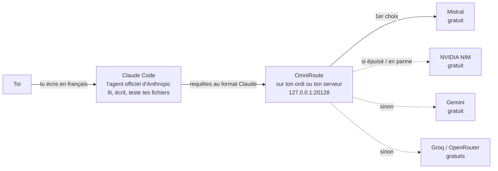

# GUIDE COMPLET · Kit Claude Gratuit (Brennan SONNET)

> Fichier à joindre à Claude (claude.ai, même gratuit) avec le texte de PROMPT-POUR-CLAUDE-GRATUIT.txt. Il contient tout le guide officiel du kit. Généré automatiquement.

## Le guide de démarrage (00-LIS-MOI-EN-PREMIER.txt)

```text
==========================================================================
  KIT CLAUDE GRATUIT  ·  par Brennan SONNET
  Claude Code (l'agent qui crée sites, applis, jeux) gratuitement,
  grâce à OmniRoute. Installation : 1 double-clic, 10 à 15 minutes.
==========================================================================

C'EST QUOI ?
- Claude Code : l'outil officiel d'Anthropic qui crée des sites, des
  applications, des jeux vidéo, des scripts, directement sur ton ordi.
- D'habitude il faut un abonnement Claude payant. Ici on le branche sur
  des modèles d'IA GRATUITS (Mistral, NVIDIA, Google Gemini...) grâce à
  OmniRoute, un « aiguilleur » gratuit et open source.
- Si un modèle gratuit est épuisé ou en panne, OmniRoute passe tout seul
  au suivant (testé).

CE QU'IL TE FAUT
- Un PC Windows 10/11 ou un Mac (ou un serveur Linux si tu en as déjà un).
  2 Go de RAM libres et 2 Go de disque.
- Internet.
- Au moins 1 clé gratuite (étape 1). La meilleure : Mistral.
- Pas besoin de savoir coder. Pas besoin de carte bancaire.

--------------------------------------------------------------------------
ÉTAPE 1 : RÉCUPÈRE TES CLÉS GRATUITES  (2 minutes chacune)
--------------------------------------------------------------------------
 Une clé = un mot de passe. Ne la publie jamais, ne la colle jamais dans
 un chat. Garde-la dans un coin (Bloc-notes) le temps de l'installation.

 A. MISTRAL  (recommandé n°1 : ~1 milliard de tokens par mois, français)
    1. Va sur https://console.mistral.ai  et crée un compte.
    2. Choisis le plan « Experiment » (gratuit : vérification par SMS,
       pas de carte bancaire).
    3. Menu « API Keys » > « Create new key » > copie la clé.

 B. NVIDIA  (recommandé n°2 : environ 40 requêtes par minute)
    1. Va sur https://build.nvidia.com  > « Login » > crée un compte.
    2. Va sur https://build.nvidia.com/settings/api-keys
       > « Generate API Key » > copie la clé.

 C. GOOGLE GEMINI  (secours : ton compte Google suffit)
    1. Va sur https://aistudio.google.com/apikey  > « Create API key ».

 Bonus (secours) : Groq https://console.groq.com/keys
                   OpenRouter https://openrouter.ai/keys
 Pas de clé tout de suite ? Installe quand même : tu les ajouteras après
 avec la commande  kit-claude ajouter-cle

--------------------------------------------------------------------------
ÉTAPE 2 : INSTALLE
--------------------------------------------------------------------------
 Tu as DÉJÀ un serveur (VPS, NAS) ? Va à la partie SERVEUR plus bas :
 c'est le meilleur choix. Pas de serveur (la plupart des gens) ? Pas
 besoin d'en louer un : WINDOWS ou MAC ci-dessous.

 WINDOWS
    1. Double-clique sur  DEMARRER-WINDOWS.bat
       Si Windows dit « Windows a protégé votre ordinateur » :
       « Informations complémentaires » > « Exécuter quand même ».
    2. Réponds aux questions (Entrée = réponse recommandée) :
       - « As-tu un abonnement Claude payant ? » : tape o si tu as Claude
         Pro ou Max (ton Claude actuel ne sera pas touché), sinon Entrée.
       - « Installer Git ? » : Entrée, puis « Oui » si Windows demande
         l'autorisation (c'est la seule fois).
       - Tes clés : clic droit dans la fenêtre noire pour coller.
         (Normal : la clé s'affiche en étoiles.)
    3. Des lignes jaunes ou en anglais défilent : normal, ne touche à rien.
    4. NOTE LE MOT DE PASSE affiché (oublié ? kit-claude mot-de-passe).

 MAC
    1. Ouvre l'app Terminal (Cmd + Espace, tape « Terminal », Entrée).
    2. Colle cette ligne (Cmd + V) puis Entrée :
       curl -fsSL https://raw.githubusercontent.com/Camel974/kit-claude-gratuit/main/installer.sh | bash
       (Ou double-clic sur DEMARRER-MAC.command. Si macOS le bloque :
        Réglages Système > Confidentialité et sécurité > « Ouvrir quand
        même ». Si le Terminal demande l'accès à Téléchargements :
        « Autoriser ».)
    3. Mêmes questions que sur Windows. Pour coller une clé : Cmd + V.
    4. NOTE LE MOT DE PASSE affiché.

 SERVEUR (VPS, NAS Linux) : prioritaire si tu en as un, il tourne
 24 h/24 et tu y accèdes depuis n'importe quel ordi.
    1. Connecte-toi :  ssh root@ADRESSE-IP-DU-SERVEUR
    2. Colle cette ligne puis Entrée :
       curl -fsSL https://raw.githubusercontent.com/Camel974/kit-claude-gratuit/main/installer.sh | bash -s -- --serveur
    3. Réponds aux questions. Guide détaillé : docs/03-installation-serveur.md

 LINUX (PC) : bash installer.sh   (dans ce dossier)

 WINDOWS EN UNE LIGNE, SANS DÉZIPPER (PowerShell) :
   irm https://raw.githubusercontent.com/Camel974/kit-claude-gratuit/main/scripts/installer-windows.ps1 | iex

--------------------------------------------------------------------------
ÉTAPE 3 : UTILISE CLAUDE
--------------------------------------------------------------------------
 LE PLUS SIMPLE : double-clic sur « Claude Gratuit » sur ton Bureau.
 Claude s'ouvre directement dans ton dossier de projets.

 Sinon, à la main :
 1. Ouvre un NOUVEAU terminal (Windows : touche Windows, tape
    « PowerShell » ; Mac : Terminal ; serveur : ssh root@ADRESSE-IP).
 2. Tape la ligne « cd ... » affichée à la fin de l'installation
    (ton dossier Projets-Claude), puis Entrée.
 3. Tape  claude  puis Entrée
    (abonnement Claude payant : tape  claude-gratuit  pour le gratuit ;
     « claude » reste sur ton abonnement.)

 Premier lancement : tape  /bienvenue-gratuit  (8 questions à boutons,
 5 minutes) : Claude apprend ce que tu veux faire et te propose ton
 premier projet. Ensuite, écris normalement, par exemple :
      « fais-moi un jeu de voiture jouable sur téléphone »
      « écris un script qui renomme mes photos avec leur date »
      « crée-moi une page simple pour m'entraîner au web »
 À savoir : les skills Site et Appli de Brennan commencent par te
 demander ton chiffre d'affaires (règle : le site, c'est après
 3 000 €/mois, sauf pour un client qui paie).

 Les 3 écrans à connaître :
 - « Do you trust the files in this folder? » : flèche du BAS puis
   Entrée sur « Yes, I trust this folder ». (Entrée tout de suite =
   « No, exit » et Claude se ferme. Vu en test.)
 - « Do you want to proceed? » (avant une commande ou une modification) :
   tape 1 (oui) ou 2 (oui, et ne plus demander pour ce type d'action).
   En mode gratuit, jamais 3 (« auto mode ») : il ne marche pas avec
   OmniRoute (vu en test).
 - En haut, « gratuit · API Usage Billing » : normal, tu ne paies rien.

 Tu as un abonnement Claude ? Limite atteinte : tape /exit, puis
 claude-gratuit -c  (reprend la même conversation en gratuit).
 Si claude-gratuit te parle de « /logout » : ne le fais JAMAIS (ça
 déconnecterait ton abonnement).

--------------------------------------------------------------------------
SI ÇA BLOQUE
--------------------------------------------------------------------------
 1. Dans un terminal, tape :  kit-claude diagnostic
    Le rapport s'ouvre dans le Bloc-notes : Ctrl+A puis Ctrl+C.
 2. Colle-le sur https://claude.ai (même la version gratuite) avec la
    phrase du fichier PROMPT-POUR-CLAUDE-GRATUIT.txt
 3. Toutes les solutions : docs/07-depannage.md

 Les 3 problèmes les plus fréquents :
  - « claude n'est pas reconnu » : ferme et rouvre le terminal.
  - « ECONNREFUSED » : OmniRoute est éteint. Tape :  kit-claude demarrer
  - « 429 » ou « quota » : le quota gratuit du moment est épuisé.
    Attends 1 minute, ou ajoute une clé :  kit-claude ajouter-cle

--------------------------------------------------------------------------
LES COMMANDES À CONNAÎTRE
--------------------------------------------------------------------------
 claude                    lancer Claude Code (dans le dossier du projet)
 claude-gratuit            idem en mode gratuit (si tu as un abonnement)
 /bienvenue-gratuit        régler Claude sur toi (une fois)
 /compact                  résumer la conversation (économise le quota)
 /clear                    repartir de zéro (nouveau sujet)
 kit-claude ajouter-cle    ajouter une clé gratuite
 kit-claude bascule        remettre à jour l'ordre de bascule des modèles
 kit-claude demarrer       relancer OmniRoute
 kit-claude mot-de-passe   nouveau mot de passe du tableau de bord
 kit-claude diagnostic     trouver la panne
 kit-claude mise-a-jour    tout mettre à jour (kit, OmniRoute, Claude)
 Tableau de bord OmniRoute : http://127.0.0.1:20128
   (fournisseurs, quotas restants, ordre de bascule des modèles)

--------------------------------------------------------------------------
À SAVOIR (en toute honnêteté)
--------------------------------------------------------------------------
 - Ce ne sont PAS les modèles Claude d'Anthropic : c'est l'outil Claude
   Code avec des modèles gratuits. Très bien pour des sites, applis et
   jeux ; en dessous de Claude Opus/Sonnet sur les très gros projets.
   Pour le maximum : abonnement Claude Pro + « claude-gratuit » en secours.
 - Les routes « Claude Opus gratuit » via Kiro ou Antigravity existent,
   mais leurs conditions d'utilisation l'interdisent (OmniRoute les marque
   « à éviter ») : ton compte peut être banni. Le kit ne les utilise pas.
 - Offres gratuites = tes messages peuvent servir à entraîner les modèles
   (Mistral Experiment, Gemini gratuit). Pas de données clients sensibles.
 - Les offres gratuites changent souvent : le tableau de bord OmniRoute
   affiche les quotas en direct et la bascule automatique fait le reste.
 - Sécurité : OmniRoute n'écoute que ton ordi (127.0.0.1) et exige une
   clé. Rien n'est visible depuis ton Wi-Fi ou Internet.

==========================================================================
 Kit créé par Brennan SONNET · Instagram @brennansonnet_974
 Gratuit, interdit à la revente. Version 1.0, testée le 18/11/2026
 (Claude Code 2.1.327, OmniRoute 3.8.54, Node.js 26).
 Mises à jour : https://github.com/Camel974/kit-claude-gratuit
==========================================================================
```

## 01 · Comment ça marche (en 2 minutes)



- **Claude Code** : le programme d'Anthropic qui travaille dans tes dossiers (créer des fichiers, lancer des commandes, tester un site). Il est gratuit à installer ; ce qui coûte normalement, c'est le modèle d'IA derrière.
- **OmniRoute** : un logiciel libre (licence MIT) qui se fait passer pour l'API de Claude. Claude Code lui envoie ses requêtes, OmniRoute les traduit et les envoie à un modèle gratuit.
- **La combinaison `gratuit`** : la liste ordonnée de tes modèles gratuits. Si le premier répond « quota épuisé » ou tombe en panne, OmniRoute passe au suivant **tout seul**, sans que tu voies rien.

## Ce qu'on a vérifié en vrai (18/11/2026)
| Test | Résultat |
|---|---|
| Claude Code 2.1.327 → OmniRoute 3.8.54 → fournisseur | ✅ réponse reçue, traduction automatique du format |
| 1er fournisseur en panne (erreur 401) dans la combinaison | ✅ bascule automatique sur le 2e, réponse normale |
| Installation complète sur une machine vierge (sans Node ni Claude) | ✅ Node 26 + Claude Code + OmniRoute + config, voir 02 |
| Démarrage de Claude Code avec le kit | ✅ aucun écran de connexion Anthropic, aucun écran d'accueil |
| Fournisseurs « sans clé » (Pollinations, UncloseAI) | ❌ demandent une clé aujourd'hui : il faut 1 clé gratuite minimum |
| Coût fixe d'un message Claude Code | ~14 000 tokens (mesuré) |

## Gratuit, mais pas magique (comparatif honnête)
| | Kit gratuit (ce kit) | Claude Pro (~20 €/mois) | Kiro / Antigravity « Claude gratuit » |
|---|---|---|---|
| Outil | Claude Code | Claude Code | Claude Code via proxy |
| Modèle | Mistral, NVIDIA, Gemini... | Claude Sonnet / Opus | Claude Sonnet / Opus |
| Qualité sur gros projets | bonne à très bonne | excellente | excellente |
| Coût | 0 € | abonnement | 0 € |
| Conditions d'utilisation | respectées (usage perso) | respectées | **violées** : risque de compte banni |
| Limites | quotas gratuits (bascule auto) | limites de l'abonnement | quotas minuscules + bannissement |

La stratégie la plus solide si tu as un peu de budget : **Claude Pro en principal** (`claude`) et **le kit en secours** (`claude-gratuit`) quand tu atteins la limite. L'installeur te pose la question.

## Ta vie privée
- OmniRoute tourne chez toi : pas d'intermédiaire dans le cloud, tes clés sont chiffrées sur ton disque.
- Mais chaque requête part chez le fournisseur choisi (Mistral, Google...). Les offres gratuites peuvent utiliser tes requêtes pour entraîner leurs modèles. Pas de mots de passe, pas de données clients sensibles dans tes conversations.


## 02 · Installation sur PC (Windows, Mac, Linux)

> Tu as un serveur (VPS, NAS) ? Va plutôt sur 03-installation-serveur.md : c'est mieux.

## Avant de commencer (2 minutes)
- Récupère au moins 1 clé gratuite : 04-cles-gratuites.md (Mistral recommandé).
- Télécharge le kit : https://github.com/Camel974/kit-claude-gratuit/archive/refs/heads/main.zip puis **dézippe** (clic droit → « Extraire tout » sur Windows, double-clic sur Mac).

## Windows 10 / 11
1. Ouvre le dossier `kit-claude-gratuit-main` et **double-clique sur `DEMARRER-WINDOWS.bat`**.
   - Écran bleu « Windows a protégé votre ordinateur » : **Informations complémentaires** → **Exécuter quand même**.
2. Le script installe ce qui manque, sans droits administrateur :
   - Node.js (dans ton dossier perso), Git pour Windows (optionnel, Windows peut demander une autorisation), Claude Code (installeur officiel), OmniRoute.
3. Réponds aux questions (voir plus bas). Pour **coller** une clé dans la fenêtre noire : **clic droit**.
   - « Installer Git pour Windows ? » : Entrée, puis **Oui** quand Windows demande l'autorisation (c'est la seule fois). Git donne à Claude un vrai terminal ; sans lui, Claude utilise PowerShell.
4. Des lignes jaunes `npm warn ...` défilent pendant 2 minutes : **c'est normal**.
5. Fin : `C'EST PRET !` → note le **mot de passe** du tableau de bord.

Sans dézipper : ouvre PowerShell et colle
```powershell
irm https://raw.githubusercontent.com/Camel974/kit-claude-gratuit/main/scripts/installer-windows.ps1 | iex
```

## Mac
Le plus simple (aucun blocage de macOS) : ouvre l'app **Terminal** (Cmd + Espace → « Terminal ») et colle
```bash
curl -fsSL https://raw.githubusercontent.com/Camel974/kit-claude-gratuit/main/installer.sh | bash
```
Pour coller une clé : **Cmd + V**.

Avec le zip : double-clic sur `DEMARRER-MAC.command`. Si macOS refuse (« développeur non vérifié ») : **Réglages Système → Confidentialité et sécurité → « Ouvrir quand même »** (macOS 15 Sequoia ; avant : clic droit → Ouvrir). Si le Terminal demande l'accès au dossier Téléchargements : **Autoriser**.

## Linux (PC)
```bash
bash installer.sh
```

## Les questions de l'installeur (et quoi répondre)
| Question | Réponse conseillée |
|---|---|
| Où installes-tu ? | 1 (ce PC) ; 2 si tu es connecté en SSH à un serveur |
| As-tu un abonnement Claude payant (Pro ou Max) ? | **non** (Entrée) si tu n'en as pas → `claude` passe par le gratuit. **o** si tu en as un → `claude` reste ton abonnement, intact, et `claude-gratuit` passe par le gratuit dans un profil séparé. Si tu es déjà connecté à Claude sur l'ordi, « oui » est proposé par défaut |
| Mot de passe du tableau de bord | 8 caractères ou plus, ou Entrée pour qu'il en génère un (il l'affiche à la fin) |
| Colle ta clé Mistral / NVIDIA / Gemini / Groq / OpenRouter | colle celles que tu as, Entrée pour passer les autres |
| Installer le pack de skills ? | Oui (sites, applis, jeux, économie de tokens) |
| Élève SYSTEM ? | oui seulement si Brennan t'a donné accès au kit SYSTEM |
| Kit « Stories à la une » ? | oui si tu fais de l'Instagram |

## Ce que tu verras (vraie session sur une machine vierge, 18/11/2026)
Les questions :


Puis les 9 étapes. **Première installation sur une machine vierge** (ni Node, ni Claude Code) : 159 secondes au total. Ici la clé Mistral était **volontairement fausse** : le kit le voit tout de suite, explique pourquoi et dit quoi faire.


Et une fois une clé valide en place, la bascule fait son travail. Ci-dessous une relance (10 secondes) : la clé Mistral est toujours fausse, OmniRoute bascule sur le fournisseur suivant (un fournisseur de test) et Claude Code répond en 2 secondes.


Extrait (texte copiable) :
```
[5/9] Demarrage d'OmniRoute
  OK  OmniRoute demarrera tout seul a chaque allumage
  OK  OmniRoute tourne : tableau de bord http://127.0.0.1:20128
[6/9] Tes fournisseurs gratuits
  !!  Mistral (francais) enregistre, mais le test a echoue : Invalid API key
  OK  2 fournisseur(s) gratuit(s) connecte(s)
[7/9] Branchement Claude Code ↔ OmniRoute
  OK  Bascule automatique « gratuit » : mistral/mistral-medium-3-5 → mistral/mistral-large-latest → groq/openai/gpt-oss-120b → groq/qwen/qwen3.6-27b
[8/9] Skills et regles
  OK  18 skills installes
[9/9] Test final
  OK  Claude Code repond en 2 s
C'EST PRET !
```
Temps mesurés : première installation complète **159 secondes** sur un serveur 4 cœurs avec une bonne connexion (dont 2 minutes pour OmniRoute), relance **8 à 10 secondes**. Compte 10 à 15 minutes sur un PC moyen avec les questions.

## Après l'installation
1. **Double-clic sur « Claude Gratuit »** sur ton Bureau : Claude s'ouvre dans ton dossier de projets.
2. Ou à la main : ouvre un **nouveau** terminal (l'ancien ne connaît pas les nouvelles commandes), tape la ligne `cd "..."` affichée à la fin de l'installation, puis `claude` (ou `claude-gratuit`). Avec OneDrive, ton dossier Documents est souvent dans `OneDrive\Documents` : l'installeur le trouve tout seul et affiche le bon chemin.
3. Tape `/bienvenue-gratuit`.


## Ce que le kit a modifié (transparence)
| Fichier | Sans abonnement (mode gratuit) | Avec abonnement Claude | Retour arrière |
|---|---|---|---|
| Réglages Claude Code | `~/.claude/settings.json` : section `env` (OmniRoute, clé, modèle `gratuit`) + `permissions.defaultMode: manual` | rien dans `~/.claude` ; tout va dans le profil séparé `~/.claude-gratuit/` | `kit-claude desinstaller` |
| Écran d'accueil, confiance du dossier | `~/.claude.json` (accueil vu, dossier Projets-Claude autorisé) | `~/.claude-gratuit/.claude.json` | laissés tels quels (sans effet ailleurs) |
| Règles | bloc « Mode Claude Gratuit » dans `~/.claude/CLAUDE.md` (le reste intact) | `~/.claude-gratuit/CLAUDE.md` | `kit-claude desinstaller` |
| Skills | `~/.claude/skills/` (les tiens sont gardés) | `~/.claude-gratuit/skills/` | `kit-claude desinstaller` |
| OmniRoute | `~/.omniroute/.env` : `OMNIROUTE_SERVER_HOST=127.0.0.1`, `REQUIRE_API_KEY=true` | idem | à la main |
| Commandes | `claude-gratuit`, `kit-claude` dans `~/.local/bin` + raccourci Bureau | idem | `kit-claude desinstaller` |
Chaque fichier modifié est d'abord copié dans `~/.claude/backups/kit-claude-gratuit-<date>/`. Une copie du kit est gardée dans `~/.kit-claude-gratuit/kit` (Windows : `%LOCALAPPDATA%\kit-claude-gratuit\kit`) : tu peux supprimer le zip téléchargé.


## 03 · Installation sur un serveur (VPS ou NAS) : le meilleur choix

**Pourquoi le serveur en priorité ?** OmniRoute et Claude Code tournent 24 h/24, tu y accèdes depuis n'importe quel ordi (même un vieux PC, une tablette, ton téléphone), ton ordi reste léger, et les sites que Claude construit sont déjà sur une machine en ligne.

## Le serveur qu'il te faut
| | Minimum | Confortable |
|---|---|---|
| RAM | 2 Go (le kit ajoute 2 Go de swap automatiquement) | 4 Go |
| Disque | 10 Go libres (le kit en utilise ~4 : OmniRoute 3 Go, mesuré) | 20 Go |
| Système | Ubuntu 22.04/24.04 ou Debian 12 (x64 ou ARM) | idem |

Mesuré : OmniRoute utilise **~550 Mo de RAM au repos**. N'importe quel petit VPS Linux convient (Hetzner, OVHcloud, Hostinger, Contabo...). Un NAS Synology/Unraid marche aussi s'il a un accès SSH et 2 Go de RAM libres. **D'autres services tournent déjà (n8n, une base...) ?** Vise 4 Go de RAM : le kit t'avertit s'il reste moins de 1,2 Go disponible.

## Installation (10 minutes)
1. **Connecte-toi en SSH** depuis ton PC :
   - Windows : touche Windows → « PowerShell » → `ssh root@ADRESSE-IP` (SSH est inclus dans Windows 10/11).
   - Mac : app Terminal → `ssh root@ADRESSE-IP`.
   Premier contact : tape `yes` puis ton mot de passe (rien ne s'affiche quand tu tapes, c'est normal).
2. **Colle cette ligne** et Entrée :
   ```bash
   curl -fsSL https://raw.githubusercontent.com/Camel974/kit-claude-gratuit/main/installer.sh | bash -s -- --serveur
   ```
3. **Réponds aux questions** (Entrée = recommandé). Colle tes clés gratuites (clic droit sous Windows, Cmd+V sur Mac) : elles s'affichent en étoiles.
4. À la fin : `OK Claude Code répond en X s : « OK »`. **Note le mot de passe** du tableau de bord.

Ce que le script fait sur un serveur : Node.js dans ton dossier perso (pas de sudo), swap de 2 Go si moins de 3 Go de RAM (en root, avant les installations), tmux, Claude Code officiel, OmniRoute, démarrage automatique au reboot (service systemd `omniroute`, vérifié), OmniRoute verrouillé sur `127.0.0.1` + clé obligatoire. **Aucun port n'est ouvert sur Internet.**

## Travailler avec Claude sur le serveur
```bash
ssh root@ADRESSE-IP
tmux new -A -s claude
cd Projets-Claude
claude
```
**tmux** garde Claude en vie si ta connexion coupe ou si tu fermes ton PC : reconnecte-toi et retape `tmux new -A -s claude`, tu retrouves Claude là où il en était. Pour te détacher volontairement : `Ctrl+B` puis `D`.

⚠️ **Serveur partagé avec d'autres services (n8n, base de données...)** : quand Claude demande « Do you want to proceed? » pour une commande, réponds **1** (une fois), pas **2** (« ne plus demander »). Un modèle gratuit peut se tromper de commande, et en root il peut tout effacer. Les règles du kit lui interdisent les commandes destructrices sans ton OK, mais garde la main.
Astuce confort : **VS Code** (gratuit) + extension **Remote - SSH** → tu vois les fichiers du serveur comme sur ton PC, et le terminal intégré lance `claude`.

## Ouvrir le tableau de bord OmniRoute du serveur
OmniRoute n'écoute que le serveur lui-même (sécurité). Pour l'afficher sur ton PC, ouvre un **tunnel SSH** :
```bash
ssh -L 20128:127.0.0.1:20128 root@ADRESSE-IP
```
Laisse cette fenêtre ouverte, puis ouvre http://127.0.0.1:20128 dans ton navigateur.

## Utiliser l'OmniRoute du serveur depuis Claude Code sur ton PC (option)
Si tu préfères garder tes fichiers sur ton PC mais utiliser les quotas du serveur :
1. Sur ton PC, installe d'abord le kit normalement (Windows / Mac), même sans clé : ça installe Node.js, Claude Code et la commande `kit-claude`.
2. Sur le serveur, tape `kit-claude cle` et copie la clé affichée.
3. Sur ton PC : `kit-claude connecter-serveur` → adresse (`root@ADRESSE-IP`) → colle la clé (elle s'affiche en étoiles, elle ne reste pas dans l'historique).
4. Ensuite, dans un dossier de projet : `claude-serveur` (ouvre le tunnel SSH s'il n'est pas déjà ouvert, puis lance Claude Code dessus ; message clair si le tunnel échoue).
Conseil : une clé SSH (`ssh-keygen` puis `ssh-copy-id root@ADRESSE-IP`) évite de retaper le mot de passe. Sous Windows, une fenêtre « Tunnel OmniRoute » s'ouvre : laisse-la ouverte.

## Alternative Docker (serveur de 4 Go ou plus, si tu connais déjà Docker)
```bash
docker run -d --name omniroute --restart unless-stopped \
  -e OMNIROUTE_MEMORY_MB=2048 -e REQUIRE_API_KEY=true \
  -p 127.0.0.1:20128:20128 -v omniroute-data:/app/data cheaperinference/omniroute:latest
```
`cheaperinference/omniroute` est l'image indiquée par le README officiel d'OmniRoute (novembre 2026, le projet a déménagé chez `cheaper-inference`) : vérifie-le sur la page GitHub du projet avant de lui confier tes clés. L'image limite la mémoire à 1 Go par défaut ; la doc officielle conseille bien plus pour un agent de code avec de longs contextes. Sur un serveur de 2 Go, prends le script du kit (sans Docker).

## Brancher n8n (dans Docker) sur OmniRoute (avancé)
Un conteneur ne voit pas le `127.0.0.1` du serveur. Fais écouter OmniRoute sur l'adresse du pont Docker (privée, invisible depuis Internet) :
1. Dans `~/.omniroute/.env`, mets `OMNIROUTE_SERVER_HOST=172.17.0.1` (l'adresse de `docker0`, vérifie avec `ip addr show docker0`).
2. Relance l'installeur (`curl ... | bash -s -- --serveur`, 10 secondes) : il redémarre OmniRoute et rebranche Claude Code et `kit-claude` sur cette adresse. Il garde une adresse privée comme celle-ci à chaque relance (jamais `0.0.0.0`).
3. Crée une clé dédiée à n8n : tableau de bord → Gestionnaire d'API → Créer une clé.
4. Dans n8n : nœud « OpenAI » / « OpenAI Chat Model » → URL de base `http://172.17.0.1:20128/v1`, clé = celle de l'étape 3, modèle `gratuit`.
Le tunnel SSH vers le tableau de bord devient alors : `ssh -L 20128:172.17.0.1:20128 root@ADRESSE-IP`.

## Sécurité serveur (à faire une fois)
- Mot de passe root solide ou, mieux, connexion par clé SSH uniquement.
- Mises à jour : `apt update && apt upgrade -y` de temps en temps.
- N'ouvre **jamais** le port 20128 sur Internet. Pour un accès depuis plusieurs appareils sans tunnel, utilise un réseau privé type Tailscale (gratuit pour un usage perso) plutôt qu'un port public.

## Dépannage serveur
| Problème | Solution |
|---|---|
| `curl: command not found` | `apt install -y curl` (Debian/Ubuntu) puis relance |
| « Lance ce script SANS sudo » | tape la commande sans `sudo` (ou connecte-toi directement en root) |
| OmniRoute ne redémarre pas après un reboot | en root : `systemctl status omniroute` ; sinon `systemctl --user status omniroute` (+ `sudo loginctl enable-linger $USER`) ; sinon relance l'installeur |
| `claude` ou `kit-claude` : « command not found » après reconnexion | reconnecte-toi (le kit ajoute `~/.local/bin` au PATH) ; sinon `export PATH="$HOME/.local/bin:$PATH"` |
| Claude s'est arrêté quand la connexion a coupé | utilise `tmux new -A -s claude` avant `claude` |
| Le serveur rame | `free -h` : si la RAM est pleine, prends 4 Go ou ferme d'autres services |
| Tout le reste | `kit-claude diagnostic` et 07-depannage.md |


## 04 · Tes clés gratuites (pas à pas)

Une **clé API** = le mot de passe qui permet à OmniRoute d'utiliser un modèle d'IA en ton nom. Elle est gratuite, mais personnelle : ne la publie jamais, ne la colle jamais dans un chat (même avec Claude). Tu la colles seulement dans l'installeur ou dans `kit-claude ajouter-cle`.

> Testé le 18/11/2026 : **aucun fournisseur « sans clé » ne marche aujourd'hui** (Pollinations et UncloseAI répondent « clé obligatoire »), même si certains catalogues disent le contraire. Il te faut donc au moins 1 clé. Compte 2 minutes par clé.

## Lesquelles prendre ?

| Fournisseur | Quota gratuit (catalogue OmniRoute, nov. 2026) | Ce qu'il faut | Rôle dans le kit |
|---|---|---|---|
| **Mistral** (France) | ~1 milliard de tokens/mois, ~1 requête/s | compte + SMS, pas de carte | **n°1** : gros volume, bon en code |
| **NVIDIA NIM** | sans plafond de tokens publié, ~40 requêtes/min | compte NVIDIA | **n°2** : bascule quand Mistral sature |
| **Google Gemini** | quota par jour assez bas (de 20 à quelques centaines de requêtes selon le modèle) | compte Google | secours, contexte géant (1 million de tokens) |
| **Groq** | petits quotas quotidiens, très rapide | compte | secours rapide |
| **OpenRouter** | modèles `:free`, ~50 requêtes/jour | compte | dernier secours |

Combien de clés selon ton usage (estimation : 1 h de travail actif ≈ 60 à 120 requêtes ≈ 2 à 4 millions de tokens) :
- **Moins de 2 h/semaine** : Mistral suffit.
- **2 à 5 h** : Mistral + NVIDIA (la bascule automatique prend le relais).
- **5 à 15 h** : Mistral + NVIDIA + Gemini.
- **Plus de 15 h** : ajoute Groq + OpenRouter, ou prends l'abonnement Claude Pro pour les grosses semaines.

## A. Mistral (recommandé n°1)
1. Va sur https://console.mistral.ai et crée un compte (e-mail ou Google).
2. On te propose un abonnement : choisis **« Experiment »** (gratuit). Mistral vérifie ton numéro de téléphone par SMS. Pas de carte bancaire.
3. Dans le menu, ouvre **« API Keys »** → **« Create new key »** → donne un nom (ex. `omniroute`) → **copie la clé** (elle ne s'affiche qu'une fois).
4. À savoir : avec le plan Experiment, Mistral peut utiliser tes requêtes pour entraîner ses modèles. Pas de données sensibles de clients.

## B. NVIDIA NIM (recommandé n°2)
1. Va sur https://build.nvidia.com → **Login** → crée un compte NVIDIA.
2. Ouvre https://build.nvidia.com/settings/api-keys → **« Generate API Key »** → copie (commence par `nvapi-`).
3. Usage prévu par NVIDIA : prototypage, développement, apprentissage. Parfait pour tes projets perso.

## C. Google Gemini (secours)
1. Va sur https://aistudio.google.com/apikey (connecté à ton compte Google).
2. **« Create API key »** → choisis ou crée un projet → copie (commence par `AIza`).
3. Le quota gratuit est compté par jour (remise à zéro à minuit, heure du Pacifique). Les requêtes gratuites peuvent servir à améliorer les produits Google.

## D. Groq (bonus)
https://console.groq.com/keys → **« Create API Key »** → copie (commence par `gsk_`).

## E. OpenRouter (bonus)
https://openrouter.ai/keys → **« Create Key »** → copie (commence par `sk-or-`). Seuls les modèles qui finissent par `:free` sont gratuits.

## Ajouter une clé plus tard
Dans un terminal :
```bash
kit-claude ajouter-cle
```
Choisis le fournisseur, colle la clé (elle s'affiche en étoiles, c'est normal). Le kit la teste, puis reconstruit la bascule automatique `gratuit`.

Tu peux aussi passer par le tableau de bord (en français) :
1. Ouvre http://127.0.0.1:20128 et connecte-toi avec le mot de passe affiché à la fin de l'installation.


2. **Fournisseurs** → filtre **« Niveau gratuit »** → choisis le fournisseur (ex. Mistral).


3. **Ajouter** → colle la clé dans **« Clé API »** → **Vérifier** → **Enregistrer**. Puis tape `kit-claude bascule` dans un terminal pour que la bascule `gratuit` l'intègre.


Si la connexion affiche **« Invalid API Key »** en rouge : la clé est mal copiée ou le compte n'est pas encore activé. Recopie-la.


## Ce que le kit n'utilise volontairement pas
| Route | Pourquoi on l'évite |
|---|---|
| **Kiro** (Claude Sonnet gratuit) | Ses conditions interdisent les outils tiers comme OmniRoute. OmniRoute la marque `avoid` et l'exclut du routage auto. Risque : compte banni. |
| **Antigravity** (Claude Opus gratuit) | Les conditions de Google Antigravity interdisent l'accès via des proxys. Marquée `avoid`. Même risque. |
| Créer plusieurs comptes pour cumuler les quotas | Interdit par la plupart des fournisseurs. Un compte par personne. |
| Partager ton OmniRoute avec d'autres personnes | La plupart des conditions interdisent la revente ou le partage. Chaque élève installe le sien. |


## 05 · Premiers pas avec Claude Code

## Lancer
Le plus simple : **double-clic sur « Claude Gratuit »** sur ton Bureau.

À la main (la ligne `cd` exacte est affichée à la fin de l'installation) :
```bash
cd Documents/Projets-Claude      # serveur : cd Projets-Claude (dans tmux)
claude                           # ou claude-gratuit si tu as un abonnement Claude
```
Un projet = un dossier. Pour un nouveau projet, tape ces 3 lignes l'une après l'autre (Windows PowerShell n'accepte pas `&&`) :
```bash
mkdir mon-jeu
cd mon-jeu
claude
```

## Les 2 écrans à connaître
- **« Do you want to proceed? »** (avant une commande ou une modification) : `1` = oui, `2` = oui et ne plus demander pour ce type d'action, `4` = non. En mode gratuit, **jamais `3` (« switch to auto mode »)** : le mode auto vérifie les actions sur les serveurs d'Anthropic, il ne marche pas avec OmniRoute (le kit règle Claude en mode « manual » pour ça). Avec ton abonnement Claude (commande `claude`), le mode auto marche normalement.
- En haut de l'écran, **« gratuit · API Usage Billing »** : c'est le nom de la bascule du kit et un libellé standard de Claude Code. Tu ne paies rien : c'est OmniRoute qui répond.

## Les 10 commandes à connaître (dans Claude Code)
| Tape | Effet |
|---|---|
| `/bienvenue-gratuit` | règle Claude sur toi (une fois) |
| `/compact` | résume la conversation : économise le quota |
| `/clear` | repart de zéro (nouveau sujet) |
| `/context` | ce qui remplit la mémoire de Claude |
| `/model` | voir ou changer le modèle (le kit utilise `gratuit`) |
| `Maj + Tab` | change de mode : manuel (il demande) → modifications acceptées → plan (évite le mode auto) |
| `Échap` | interrompre Claude |
| `Échap` `Échap` | revenir en arrière dans la conversation |
| `@fichier` | montrer un fichier précis à Claude |
| `!commande` | lancer une commande du terminal sans quitter Claude |

## Recettes (copie-colle et adapte)
**Site qui vend** (skill `site-express`)
> Crée-moi un site pour mon activité de [coach sportif à Lyon]. Pose-moi tes questions d'abord.

À savoir : les skills Site et Appli de Brennan commencent par ton chiffre d'affaires. Sa règle : le site ou l'appli, c'est **après 3 000 €/mois** (avant, ce qui fait vendre c'est le contenu, les DM et les appels) ; exception : **un client qui te paie**. Pour t'entraîner sans business : « Sans le skill site-express, fais-moi une page simple pour m'entraîner au web ».

**Application** (skill `app-web`, même règle)
> Crée une application pour suivre mes clients : nom, téléphone, prochain rendez-vous, notes. Commence par la version la plus simple.

**Jeu vidéo** (skill `jeu-express`)
> Fais-moi un jeu original jouable sur téléphone : un runner où on saute entre des toits. Pose tes questions, puis prototype jouable.

**Copier le style d'un site** (skill `clone-site`)
> Refais la structure et le style de cette page à ma marque : [lien]. Pas leurs textes ni leurs images.

**Business et contenu**
> Écris la page de vente de mon offre [X] pour [cible], avec les objections et une FAQ. Montre-moi d'abord le plan.

**Automatiser**
> Écris un script qui renomme toutes les photos de ce dossier avec la date, et teste-le sur 3 fichiers d'abord.

## Les skills du kit
| Skill | Pour |
|---|---|
| `bienvenue-gratuit` | ton profil + plan de fournisseurs + premier projet |
| `site-express`, `clone-site`, `fusion-sites`, `audit-site`, `design-premium`, `simulation-visiteurs` | sites qui convertissent (kit Sites de Brennan) |
| `app-web`, `supabase` | applications avec comptes et base de données |
| `jeu-express`, `webapp-testing` | jeux navigateur testés automatiquement |
| `frontend-design`, `cro`, `copywriting`, `web-quality-audit` | design, conversion, textes, qualité (skills libres reconnus) |
| `econome` | faire durer les quotas gratuits |
| `depannage-gratuit` | réparer quand ça bloque |
| `skill-creator` | créer tes propres skills |
Tu n'as pas besoin de les appeler : Claude les choisit selon ta demande. Tu peux forcer avec `/nom-du-skill`.

## Bien travailler avec un modèle gratuit
- **Découpe** : « fais la page d'accueil » puis « ajoute le formulaire », plutôt que tout le site d'un coup.
- **Fais vérifier** : « lance le site et fais une capture d'écran », « teste sur mobile ».
- **Corrige vite** : si Claude part dans la mauvaise direction, `Échap` puis dis-lui ce qui ne va pas.
- **Sauvegarde** : demande « initialise git et fais un commit » avant une grosse modification.
- Un projet sérieux qui coince (gros code, bug complexe) : c'est le moment où Claude Pro fait la différence.

## Tu as un abonnement Claude (Pro / Max) ?
- `claude` = ton abonnement, **jamais modifié** par le kit. `claude-gratuit` = le mode gratuit, dans un profil séparé (`~/.claude-gratuit` : ses propres réglages, règles et skills).
- Limite atteinte (« usage limit reached ») : tape `/exit`, puis `claude-gratuit -c` : la **même conversation** continue en gratuit (l'historique est partagé).
- Si `claude-gratuit` affiche un message sur l'authentification ou propose `/logout` : **ne fais jamais `/logout`** (ça déconnecterait ton abonnement). Ignore le message.


## 06 · Économiser les quotas gratuits

Le détail est dans le skill `econome` (Claude l'applique tout seul). L'essentiel :

## Les chiffres mesurés (18/11/2026)
| Mesure | Valeur |
|---|---|
| Coût fixe d'un message (instructions + outils de Claude Code) | **~14 000 tokens** en mode interactif, ~11 700 en mode `-p` |
| Avec 12 skills installés | +1 600 tokens par message |
| Avec 256 skills installés | +6 000 tokens par message (et Claude ne voit plus toutes leurs descriptions) |
| 1 action (lire un fichier, lancer une commande) | 1 aller-retour de plus, avec tout l'historique |
| Grosse sortie de commande (848 Ko) | Claude Code n'envoie qu'un aperçu de ~2 400 caractères |
| Compression OmniRoute sur des sorties de commandes (aperçu officiel) | -55 % (RTK), -64 % (RTK + Caveman), 0 % sur du texte normal |

## Les 8 réflexes
1. Un sujet = une conversation : `/clear` entre deux sujets, `/compact` quand ça s'allonge.
2. Une demande complète en un message plutôt que 5 petits.
3. Mode plan (`Maj + Tab`) avant les gros changements.
4. Cible les fichiers (`@src/index.html`) au lieu de « regarde mon projet ».
5. Pas de gros copier-coller : le chemin du fichier ou 20 lignes d'erreur.
6. CLAUDE.md court (il est envoyé à chaque message).
7. Range les skills inutiles dans `~/.claude/skills-off/`.
8. Pas de sous-agents pour des petites tâches.

## Combien de temps dure le gratuit ? (estimations)
Hypothèse : 1 h de travail actif ≈ 60 à 120 requêtes ≈ 2 à 4 millions de tokens.
| Fournisseur | Ce que ça donne en pratique |
|---|---|
| Mistral (~1 milliard/mois) | largement de quoi travailler plusieurs heures par jour |
| NVIDIA (~40 requêtes/min, pas de plafond de tokens publié) | limité par la vitesse, pas par le volume |
| Gemini gratuit (20 à quelques centaines de requêtes/jour selon le modèle) | de 10 minutes à 2 h par jour : en secours |
| Groq / OpenRouter | quelques dizaines de requêtes : dernier secours |
Les quotas réels de ton compte sont dans le tableau de bord : **Coûts → Budget de l'offre gratuite** et **Quota du fournisseur**.


## Changer l'ordre de la bascule
Tableau de bord http://127.0.0.1:20128 → **Combinaisons** → `gratuit` → glisse les modèles. Ou relance `kit-claude ajouter-cle` : il reconstruit l'ordre recommandé (Mistral → NVIDIA → Gemini → Groq → OpenRouter).


## 07 · Dépannage (problème → solution)

**Réflexe n°1** : dans un terminal, tape `kit-claude diagnostic`. Chaque ligne en MAJUSCULES dit quoi faire. Le rapport est aussi enregistré dans `~/.kit-claude-gratuit/diagnostic.txt` (Windows : `%LOCALAPPDATA%\kit-claude-gratuit\diagnostic.txt`).

**Réflexe n°2** : copie ce rapport + le message d'erreur exact sur https://claude.ai (la version gratuite suffit) avec la phrase de PROMPT-POUR-CLAUDE-GRATUIT.txt.

Exemple de rapport (installation réelle, 18/11/2026) :
```
  Node.js                v26.13.1 OK
  Claude Code            2.1.327 (Claude Code)
  OmniRoute installe     oui (3.8.54)
  OmniRoute en marche    oui (http://127.0.0.1:20128)
  Donnees OmniRoute      /home/eleve/.omniroute (prive 127.0.0.1)
  Mode Claude            global (claude → http://127.0.0.1:20128, modele gratuit)
  Cle d'acces            valide (sk-af4...04f3), 391 modeles visibles
  Fournisseurs           groq, mistral
  Bascule « gratuit »    mistral/mistral-medium-3-5 → mistral/mistral-large-latest → groq/openai/gpt-oss-120b → ...
```

## Pendant l'installation
| Symptôme | Cause | Solution |
|---|---|---|
| Windows : « Windows a protégé votre ordinateur » | fichier téléchargé d'Internet | Informations complémentaires → Exécuter quand même |
| Windows : « l'exécution de scripts est désactivée » | règle PowerShell | passe par `DEMARRER-WINDOWS.bat` (il contourne la règle pour ce script seulement) |
| Mac : « impossible d'ouvrir car le développeur ne peut pas être vérifié » | Gatekeeper | Réglages Système → Confidentialité et sécurité → « Ouvrir quand même » (avant macOS 15 : clic droit → Ouvrir) ; ou la ligne `curl ... \| bash` dans le Terminal (jamais bloquée) |
| Lignes jaunes `npm warn ERESOLVE ...` | avertissements de dépendances | **normal**, attends la fin (doc officielle OmniRoute) |
| « Lance ce script SANS sudo » | `sudo bash installer.sh` | relance sans `sudo` |
| `curl: (23) Failure writing output` | ancienne version du script | télécharge la dernière version du kit (corrigé le 18/11/2026) |
| « Node.js ... ne convient pas » | version de Node trop vieille | le script installe sa propre version : relance-le |
| Bloqué sur « Installation d'OmniRoute » plus de 10 minutes | connexion lente | attends ; sinon Ctrl+C et relance (le script reprend) |
| « Mistral enregistré, mais le test a échoué : Invalid API key » | clé mal copiée ou compte non activé | recopie la clé (sans espace), vérifie le plan Experiment, puis `kit-claude ajouter-cle` |
| « Création automatique de la clé impossible » | OmniRoute pas encore prêt | relance l'installeur ; sinon crée la clé dans le tableau de bord (Gestionnaire d'API) et colle-la |

## Au lancement de Claude
| Symptôme | Cause | Solution |
|---|---|---|
| `claude` / `kit-claude` « n'est pas reconnu » | terminal ouvert avant l'installation | ferme et rouvre le terminal |
| Claude demande de te connecter (« Select login method ») | réglages pas chargés, ou mode abonnement | nouveau terminal ; mode abonnement : tape `claude-gratuit` |
| « Do you trust the files in this folder? » | nouveau dossier | flèche ↓ puis Entrée sur « Yes, I trust this folder » (Entrée seule = « No, exit ») |
| « Claude Code doesn't recognize the model "gratuit" » | normal avec un modèle gratuit | rien à faire |
| « gratuit · API Usage Billing » en haut | libellé standard de Claude Code | rien à faire : tu ne paies rien |
| « Auto mode can't check actions in this session » | le mode auto a été activé (option 3 ou Maj+Tab) : sa vérification passe par les serveurs d'Anthropic | **Maj+Tab** pour quitter le mode auto ; aux questions « Do you want to proceed? », réponds 1 ou 2 |

## Pendant le travail
| Symptôme | Cause | Solution |
|---|---|---|
| `ECONNREFUSED 127.0.0.1:20128`, « Unable to connect » | OmniRoute arrêté | `kit-claude demarrer` (serveur root : `systemctl restart omniroute`) |
| Windows : `omniroute` → « l'exécution de scripts est désactivée » | PowerShell bloque les scripts `.ps1` créés par npm | utilise les commandes `kit-claude ...` (elles passent par Node, pas par PowerShell) |
| `401` / « invalid api key » | clé Claude ↔ OmniRoute changée | relance l'installeur (il recrée la clé). La clé de Claude Code se voit dans le tableau de bord → Gestionnaire d'API (capture) |
| Une connexion affiche « Invalid API Key » en rouge dans le tableau de bord | clé du fournisseur mal copiée | recopie-la : `kit-claude ajouter-cle` (capture) |
| `429` / « rate limit » / « quota » | quota du moment épuisé | attends 1 minute ; ajoute un 2e fournisseur pour la bascule |
| « no eligible route » / « all targets failed » | aucun fournisseur valide | `kit-claude ajouter-cle` |
| Réponses très lentes | modèle gratuit chargé | `/compact`, ou `claude --model groq/openai/gpt-oss-120b` |
| « prompt is too long » | contexte trop gros pour le modèle | `/compact` ; si ça revient : `"CLAUDE_CODE_MAX_CONTEXT_TOKENS": "64000"` dans `~/.claude/settings.json` |
| Claude rate ses modifications, tourne en rond | modèle trop faible pour la tâche | découpe la tâche, mets Mistral Large en premier (tableau de bord → Combinaisons) |
| Mot de passe du tableau de bord oublié | | `kit-claude mot-de-passe` |
| `claude-gratuit` parle d'authentification ou propose `/logout` | abonnement Claude + mode gratuit | **ne fais jamais `/logout`** : ignore le message |
| Je ne trouve pas mon dossier Projets-Claude | Documents redirigé vers OneDrive | double-clic sur « Claude Gratuit » (Bureau) ; `kit-claude diagnostic` affiche le chemin |
| Serveur : Claude s'arrête quand la connexion SSH coupe | session fermée | `tmux new -A -s claude` avant `claude` ; après une coupure, retape-le |
| Serveur : `claude` ou `kit-claude` « command not found » après reconnexion | PATH | reconnecte-toi ; sinon `export PATH="$HOME/.local/bin:$PATH"` puis relance l'installeur |

## Remettre à zéro proprement
```bash
kit-claude desinstaller     # retire la config du kit (tes projets restent)
```
Puis relance l'installeur. Les sauvegardes sont dans `~/.claude/backups/kit-claude-gratuit-<date>/`.


## 08 · Astuces et stratégies (aller plus vite, plus loin, toujours gratuit)

## 1. Le combo gagnant si tu as 20 €/mois
**Claude Pro en principal + le kit en secours.** À l'installation, réponds « o » à la question de l'abonnement :
- `claude` → ton abonnement (vrais modèles Claude, la meilleure qualité), **jamais modifié par le kit**,
- `claude-gratuit` → OmniRoute et les modèles gratuits, dans un profil séparé (`~/.claude-gratuit`), quand tu atteins la limite ou pour les tâches simples (renommer, traduire, petites pages).
- Limite atteinte : `/exit` puis `claude-gratuit -c` → la même conversation continue en gratuit.
- Ne fais jamais `/logout` dans `claude-gratuit` (ça déconnecterait l'abonnement).
Résultat : tu ne paies jamais plus de 20 € et tu n'es jamais bloqué.

## 2. Claude.ai gratuit comme coach (sans rien installer)
La version gratuite de claude.ai ne peut pas travailler dans tes fichiers, mais elle peut te guider. Envoie-lui le fichier GUIDE-POUR-CLAUDE.md avec le texte de PROMPT-POUR-CLAUDE-GRATUIT.txt : elle te pose les bonnes questions et te donne une étape à la fois, adaptée à ton ordi.

## 3. Un serveur pour toute la famille de tes appareils
OmniRoute + Claude Code sur un petit VPS (03) : tu travailles depuis ton PC fixe, ton portable, ou même ton téléphone (app SSH type Termius) sur les mêmes projets. Avec **tmux** (`tmux new -A -s claude`), Claude continue même si tu fermes ton PC ou si la connexion coupe.

## 4. Travailler depuis le téléphone
- App SSH (Termius, Blink) → `ssh root@ton-serveur` → `cd Projets-Claude && claude`.
- Avancé : OmniRoute tourne même sur Android (Termux) d'après sa doc officielle, mais un serveur est bien plus simple.

## 5. VS Code (plus confortable que le terminal)
Installe VS Code (gratuit) + l'extension officielle **Claude Code**. Elle utilise les mêmes réglages (`~/.claude/settings.json`) : en mode global, elle passe normalement aussi par OmniRoute. Si elle te demande de te connecter, ouvre le terminal intégré de VS Code (Ctrl+ù) et tape `claude`. Sur un serveur : extension **Remote - SSH**.

## 6. Doubler la durée de tes quotas
- Applique le skill `econome` (Claude le fait seul) : `/clear` entre deux sujets, `/compact` quand ça s'allonge.
- 2 fournisseurs minimum : la bascule évite les pauses forcées.
- Les tâches mécaniques (renommer, convertir, trier) : demande un **script** plutôt que de faire faire le travail à Claude ligne par ligne. Un script = quelques requêtes, puis gratuit à l'infini.

## 7. Choisir le bon modèle pour la bonne tâche
| Tâche | Modèle conseillé (commande) |
|---|---|
| Code, site, appli | la combinaison par défaut `gratuit` (Mistral d'abord) |
| Lire un très gros document / un gros projet | `claude --model gemini/gemini-2.5-flash` (contexte d'un million de tokens) |
| Réponses instantanées, petites tâches | `claude --model groq/openai/gpt-oss-120b` |
Les identifiants exacts sont dans le tableau de bord (Fournisseurs → ton fournisseur → modèles). Abonné Claude : remplace `claude` par `claude-gratuit` dans ces commandes.

## 8. Créer tes propres skills
Tu refais souvent la même chose ? Dis : « crée-moi un skill qui fait [X] » (skill `skill-creator`). Il sera disponible dans toutes tes conversations.

## 9. Tes autres kits
- **Kit Sites** de Brennan : déjà inclus dans ce kit (site-express, clone-site, audit...).
- **Kit Stories à la une** : réponds « oui » à la question de l'installeur.
- **Kit SYSTEM** (élèves SYSTEM) : réponds « oui », puis dans Claude : « Installe le kit SYSTEM : suis le fichier INSTALL-CLAUDE.md de ~/kit-system ». Attention : ses 256 skills ajoutent ~6 000 tokens à chaque message (mesuré), garde-le pour les tâches business.

## 10. Ce qu'il ne faut PAS faire
- Utiliser Kiro ou Antigravity pour avoir Claude Opus « gratuit » : interdit par leurs conditions, OmniRoute les marque « à éviter », risque de bannissement.
- Créer 10 comptes pour cumuler les quotas, ou partager ton OmniRoute avec d'autres : interdit par la plupart des fournisseurs.
- Ouvrir le port 20128 sur Internet : n'importe qui utiliserait tes quotas.
- Coller une clé API dans un chat, un fichier de projet ou une capture d'écran publique.


## 09 · Le questionnaire (qualitatif + quantitatif)

Le kit pose ces questions à 3 moments : **l'installeur** (ce qu'il faut pour installer), le skill **`/bienvenue-gratuit`** (ce qu'il faut pour bien t'accompagner), et **Claude.ai gratuit** si tu passes par PROMPT-POUR-CLAUDE-GRATUIT.txt. Chaque question change une décision : sinon, on ne la pose pas.

## Installeur (3 minutes)
| Question | Type | Ce que ça décide |
|---|---|---|
| Où installes-tu ? (PC / serveur) | qualitatif | mode PC ou serveur (swap, service au démarrage, accès SSH) |
| As-tu un abonnement Claude Pro/Max ? | qualitatif | `claude` reste sur l'abonnement (+ `claude-gratuit`) ou passe par le gratuit |
| Mot de passe du tableau de bord | | sécurité du tableau de bord |
| Tes clés Mistral, NVIDIA, Gemini, Groq, OpenRouter | quantitatif (nombre de fournisseurs) | contenu et ordre de la bascule automatique |
| Pack de skills ? Élève SYSTEM ? Stories à la une ? | qualitatif | skills installés (et leur coût en tokens) |
Détectés tout seuls (pas de question) : système, processeur, RAM, disque libre, version de Node, Claude Code déjà là, OmniRoute déjà là, session SSH.

## `/bienvenue-gratuit` (5 minutes, boutons)
| Question | Type | Ce que ça décide |
|---|---|---|
| Ce que tu veux créer en premier (site, appli, jeu, business, automatiser, apprendre) | qualitatif | premier projet + skill à lancer |
| Ton niveau (jamais codé, un peu, je code) | qualitatif | niveau d'explication |
| Ton style (ultra court, normal, pédagogique) | qualitatif | longueur des réponses |
| Ton projet en 1 phrase | qualitatif (libre) | dossier et plan du premier projet |
| Heures par semaine avec Claude | **quantitatif** | nombre de clés gratuites à avoir (1 à 5) ou conseil Claude Pro |
| Budget IA par mois (0 €, < 10 €, ~20 €, plus) | **quantitatif** | 100 % gratuit ou Claude Pro + secours gratuit |
| Échéance du premier projet | **quantitatif** | découpage et rythme |
| Comptes disponibles (Google, téléphone, GitHub) | qualitatif | quelles clés sont faisables tout de suite |
Les réponses sont résumées en 5 à 8 lignes dans `~/.claude/CLAUDE.md` (section « Qui je suis ») : Claude s'en sert à chaque conversation.

## Pour Brennan : mesurer le kit (à mettre dans un formulaire, Tally par exemple)
1. Système : Windows / Mac / Linux / serveur.
2. Temps total d'installation (minutes).
3. Bloqué à quelle étape ? (1 à 9, ou aucune)
4. Nombre de clés gratuites créées.
5. Premier projet réalisé ? (oui / non / en cours) et lequel.
6. Note de facilité de 1 à 10.
7. Le message d'erreur exact si ça a bloqué (copier-coller).
8. Ce qui manquait dans le guide (texte libre).
Avec 20 réponses, tu sais quelle étape du guide améliorer en premier.


## Liste des skills installés
- `app-web` : Le Bâtisseur d'applications. Pour une vraie application web (comptes utilisateurs, base de données, espace membre, paiement, tableau de bord) - cadre le projet ...
- `audit-site` : L'Auditeur de site. Note n'importe quelle page (ton site en ligne, ta page locale, un concurrent) sur 100 avec une grille conversion + design premium + techniqu...
- `bienvenue-gratuit` : Premier lancement du Kit Claude Gratuit. Interview de 5 minutes (questions qualitatives et quantitatives a boutons) pour regler Claude sur la personne, verifier...
- `clone-site` : Le Cloneur de sites. Tu donnes un lien, il analyse la page (structure, couleurs, polices, espacements, animations, version mobile) et la refait à l'identique en...
- `copywriting` : "When the user wants to write or rewrite page copy (homepage, landing, pricing, feature), or asks which headline, promise, or message to lead with. Diagnoses th...
- `cro` : "When the user wants more conversions from a page or form, or asks why a page isn't converting, what to change first, or whether to add or remove a field or ele...
- `depannage-gratuit` : Dépanner le kit Claude Gratuit (Claude Code + OmniRoute) : diagnostic, tableau symptôme → solution testée, ajout de clé, mise à jour du kit, mot de passe du tab...
- `design-premium` : La checklist du design premium. Règles concrètes (typo, couleurs, espacements, grille, boutons, photos, animations, mobile) pour qu'un site fasse haut de gamme ...
- `econome` : Économiser les tokens et les quotas gratuits avec Claude Code + OmniRoute. Chiffres mesurés, réflexes qui divisent la consommation, choix du modèle, compression...
- `frontend-design` : Guidance for distinctive, intentional visual design when building new UI or reshaping an existing one. Helps with aesthetic direction, typography, and making ch...
- `fusion-sites` : Le Fusionneur. Prend 2 à 8 liens de sites, les capture et les dissèque section par section (hero, preuves, offre, témoignages, FAQ, CTA, footer, mobile), note c...
- `jeu-express` : Créer un jeu vidéo jouable dans le navigateur (ordi + mobile) sans savoir coder, de l'idée à la page itch.io. Cadrage en questions, prototype jouable en 1 sessi...
- `simulation-visiteurs` : Le Panel de visiteurs simulés. Fait visiter une page (ou 2-3 variantes) par un panel de visiteurs types construits sur l'avatar client (sceptique, pressé, curie...
- `site-express` : Le Chef de chantier web. Point d'entrée unique pour créer un site, une page de vente, une landing, un site perso premium ou une application web qui convertit. V...
- `skill-creator` : Create new skills, modify and improve existing skills, and measure skill performance. Use when users want to create a skill from scratch, edit, or optimize an e...
- `supabase` : "Use when doing ANY task involving Supabase. Triggers: Supabase products (Database, Auth, Edge Functions, Realtime, Storage, Vectors, Cron, Queues); client libr...
- `web-quality-audit` : Run an evidence-led web quality audit covering performance, accessibility, SEO, best practices, and agentic browsing. Use when asked to "audit my site", "review...
- `webapp-testing` : Toolkit for interacting with and testing local web applications using Playwright. Supports verifying frontend functionality, debugging UI behavior, capturing br...
