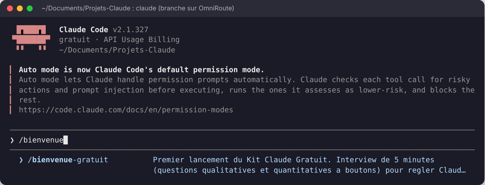
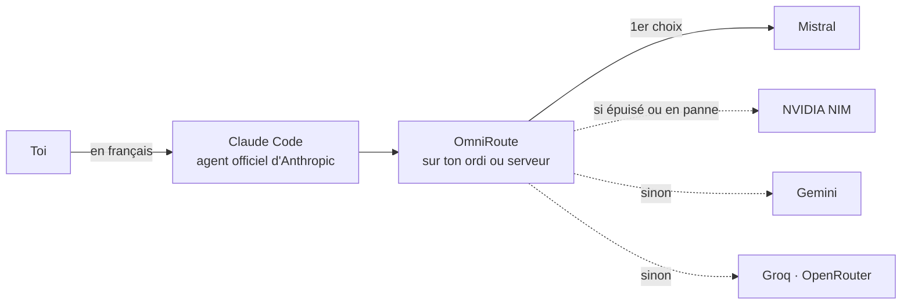
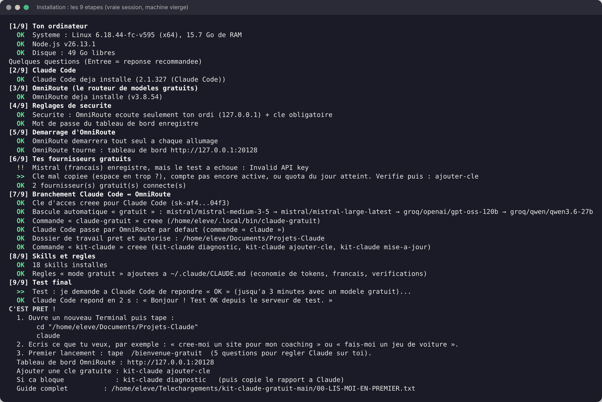
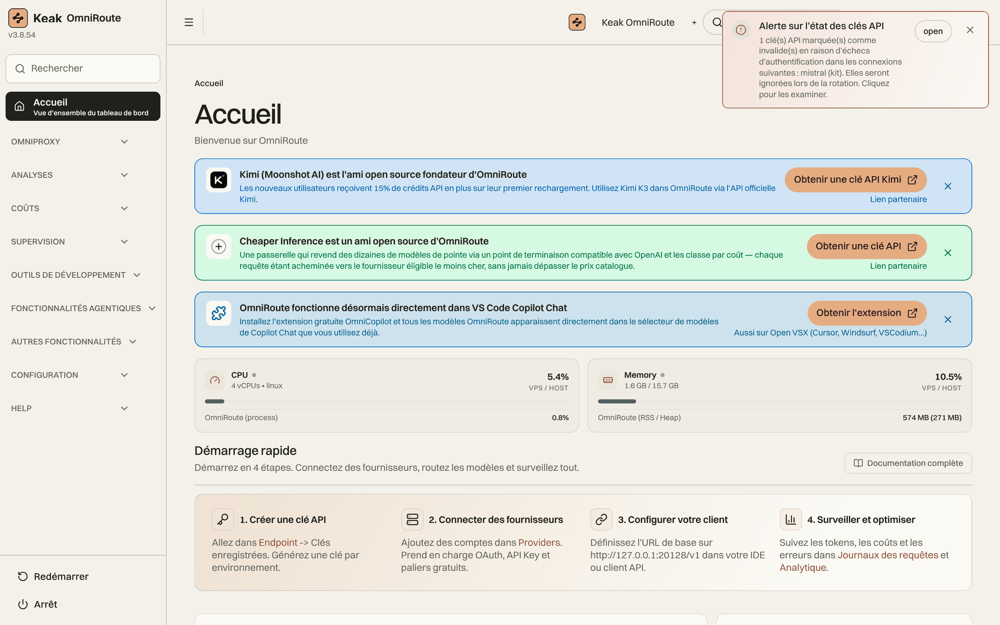
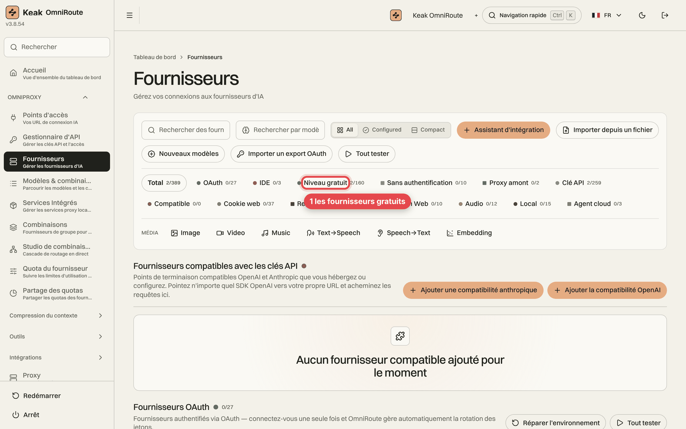
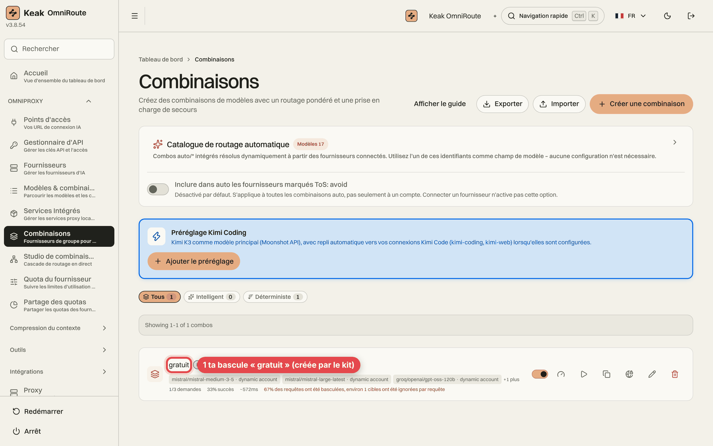
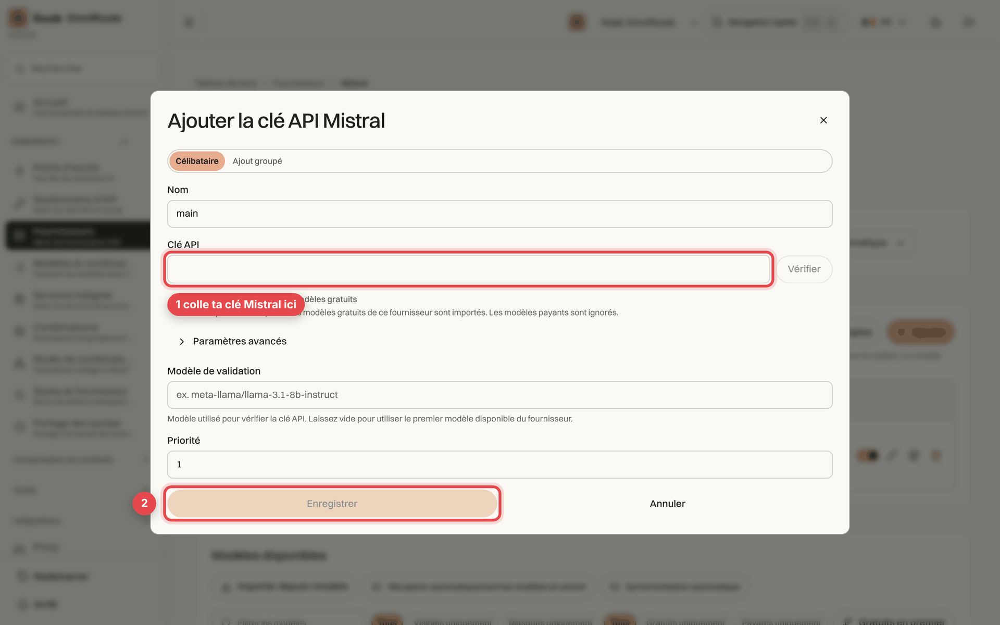
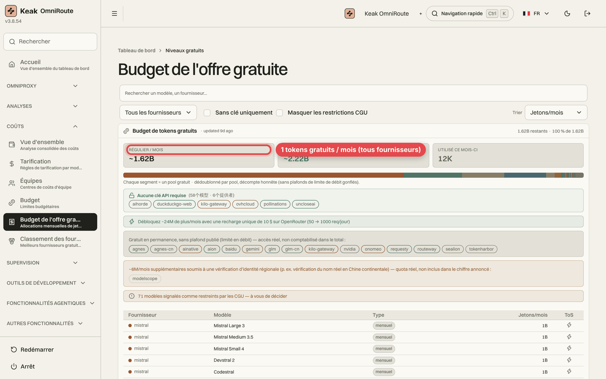

# 🆓 Kit Claude Gratuit

**Claude Code, l'agent qui crée des sites, des applis et des jeux, gratuitement, grâce à OmniRoute.**
Installation en 1 double-clic · Windows, Mac, Linux, serveur · 0 € · par **Brennan SONNET**

[📥 Télécharger le kit (.zip)](https://github.com/Camel974/kit-claude-gratuit/archive/refs/heads/main.zip) · [📝 Guide Bloc-notes](00-LIS-MOI-EN-PREMIER.txt) · [🛟 Dépannage](docs/07-depannage.md) · [🤖 Me faire guider par Claude](PROMPT-POUR-CLAUDE-GRATUIT.txt)

> 🎬 La vidéo arrive bientôt. En attendant, tout est ici, **testé en vrai le 18/11/2026** sur une machine vierge (Claude Code 2.1.327, OmniRoute 3.8.54, Node.js 26).

---

## ⚡ En 3 étapes

| | Étape | Temps |
|---|---|---|
| **1** | **Crée 1 clé gratuite** : [Mistral](https://console.mistral.ai/api-keys) (recommandé), puis [NVIDIA](https://build.nvidia.com/settings/api-keys) et [Gemini](https://aistudio.google.com/apikey) en secours. [Pas à pas avec captures →](docs/04-cles-gratuites.md) | 2 min par clé |
| **2** | **Installe** selon ton cas (tableau ci-dessous) et réponds aux questions | 10 à 15 min |
| **3** | **Utilise** : nouveau terminal → `cd Documents/Projets-Claude` → `claude` → tape `/bienvenue-gratuit` | 1 min |

## 📥 Étape 2 : installe selon ton cas

| Ton cas | Fais ça |
|---|---|
| 🖥️ **Tu as un serveur** (VPS, NAS) : *le meilleur choix* | `ssh root@IP-DU-SERVEUR` puis colle : `curl -fsSL https://raw.githubusercontent.com/Camel974/kit-claude-gratuit/main/installer.sh \| bash -s -- --serveur` [Guide serveur →](docs/03-installation-serveur.md) |
| 🪟 **Windows 10 / 11** | [Télécharge le zip](https://github.com/Camel974/kit-claude-gratuit/archive/refs/heads/main.zip), dézippe, double-clic sur **`DEMARRER-WINDOWS.bat`** |
| 🍎 **Mac** | Télécharge le zip, dézippe, **clic droit → Ouvrir** sur **`DEMARRER-MAC.command`** |
| 🐧 **Linux** | `bash installer.sh` dans le dossier du kit |
| ⚡ **Une seule ligne, sans zip** | PowerShell : `irm https://raw.githubusercontent.com/Camel974/kit-claude-gratuit/main/scripts/installer-windows.ps1 \| iex` Terminal Mac/Linux : `curl -fsSL https://raw.githubusercontent.com/Camel974/kit-claude-gratuit/main/installer.sh \| bash` |
| 🤖 **Tu veux qu'une IA te guide** | Sur [claude.ai](https://claude.ai) (gratuit) : joins [`GUIDE-POUR-CLAUDE.md`](GUIDE-POUR-CLAUDE.md) et colle le texte de [`PROMPT-POUR-CLAUDE-GRATUIT.txt`](PROMPT-POUR-CLAUDE-GRATUIT.txt) |
| 💳 **Tu as déjà Claude Pro / Max** | Installe pareil et réponds « oui » à la question de l'abonnement : `claude` = ton abonnement, `claude-gratuit` = le secours gratuit |

Guide détaillé PC : [docs/02-installation-pc.md](docs/02-installation-pc.md). Le script n'a **pas besoin des droits administrateur** et ne supprime rien (sauvegarde automatique).

## 🔧 Comment ça marche

**Claude Code** travaille dans tes dossiers (crée les fichiers, lance les commandes, teste). **OmniRoute** (logiciel libre, licence MIT) se fait passer pour l'API de Claude et envoie chaque requête à un modèle gratuit. Si le premier est épuisé ou en panne, il passe **tout seul** au suivant. [Explication complète →](docs/01-comment-ca-marche.md)

## 📸 En images

| Installation (vraie sortie, machine vierge : la clé Mistral était fausse exprès pour tester la bascule) | Tableau de bord OmniRoute (en français) |
|---|---|
|  |  |
| **Tes fournisseurs gratuits** | **La bascule automatique « gratuit »** |
|  |  |
| **Ajouter une clé (ex. Mistral)** | **Budget gratuit en direct** |
|  |  |

## ✅ Testé pour de vrai (18/11/2026)

| Test | Résultat |
|---|---|
| Installation complète sur un compte vierge (sans Node, sans Claude) | ✅ Node 26.13.1 + Claude Code 2.1.327 + OmniRoute 3.8.54 + config, en ~3 min |
| Relance de l'installeur (mise à jour) | ✅ 10 secondes, rien de cassé |
| Claude Code → OmniRoute → fournisseur | ✅ réponse reçue, aucun écran de connexion Anthropic |
| 1er fournisseur refusé (clé invalide) | ✅ bascule automatique sur le suivant, réponse en 2 s |
| Sécurité : requête sans clé / écoute réseau | ✅ refusée (401) / OmniRoute écoute seulement 127.0.0.1 |
| Fournisseurs « sans clé » (Pollinations, UncloseAI) | ❌ ils exigent une clé aujourd'hui : **1 clé gratuite minimum** |
| Coût fixe d'un message Claude Code | ~14 000 tokens (d'où le skill `econome`) |
| 3 bugs trouvés par les simulations | ✅ corrigés avant publication (téléchargement de Node, lecture du CLI, affichage) |

## 🧰 Ce que le kit installe

- **Claude Code** (installeur officiel d'Anthropic) et **OmniRoute** (open source), **Node.js** dans ton dossier perso.
- **La bascule `gratuit`** : Mistral → NVIDIA → Gemini → Groq → OpenRouter (selon tes clés).
- **18 skills** : `site-express`, `clone-site`, `fusion-sites`, `audit-site`, `design-premium`, `simulation-visiteurs`, `app-web`, `supabase` (kit Sites de Brennan) · `jeu-express` (jeux vidéo) · `bienvenue-gratuit`, `econome`, `depannage-gratuit` · `frontend-design`, `webapp-testing`, `skill-creator` (Anthropic) · `cro`, `copywriting`, `web-quality-audit` (libres).
- **Des règles « mode gratuit »** dans `~/.claude/CLAUDE.md` : français, réponses courtes, vérifications, économie de tokens.
- **2 commandes** : `claude-gratuit` (Claude via OmniRoute) et `kit-claude` (`diagnostic`, `ajouter-cle`, `mise-a-jour`, `test`, `desinstaller`).
- **Sécurité par défaut** : OmniRoute n'écoute que ton ordi (127.0.0.1) et exige une clé.
- En option : le kit **Stories à la une** et le kit **SYSTEM** (élèves SYSTEM).

## 🛟 Dépannage express

| Tu vois | Fais |
|---|---|
| `claude` n'est pas reconnu | ferme et rouvre le terminal |
| `ECONNREFUSED 127.0.0.1:20128` | `omniroute serve --no-open` |
| `429` / quota | attends 1 min, ou `kit-claude ajouter-cle` |
| Claude se ferme au démarrage | flèche ↓ puis Entrée sur « Yes, I trust this folder » |
| « Do you want to proceed? » | `1` ou `2` (jamais `3`, le mode auto ne marche pas avec OmniRoute) |
| Autre chose | `kit-claude diagnostic` puis [docs/07-depannage.md](docs/07-depannage.md) |

## ⚖️ En toute honnêteté

- Ce ne sont **pas** les modèles Claude d'Anthropic : c'est l'outil Claude Code avec des modèles gratuits. Très bien pour des sites, applis et jeux ; en dessous de Claude Opus/Sonnet sur les très gros projets. Le combo idéal avec 20 €/mois : Claude Pro + `claude-gratuit` en secours.
- Les routes « Claude Opus gratuit » via **Kiro** ou **Antigravity** violent leurs conditions d'utilisation (OmniRoute les marque `avoid`) : risque de compte banni. **Le kit ne les utilise pas.**
- Offres gratuites = tes requêtes peuvent servir à entraîner les modèles (Mistral Experiment, Gemini gratuit). Pas de données clients sensibles.
- Un compte par personne, usage perso : ne partage pas ton OmniRoute.

## 📚 Toute la doc

1. [Comment ça marche](docs/01-comment-ca-marche.md) · 2. [Installation PC](docs/02-installation-pc.md) · 3. [Installation serveur](docs/03-installation-serveur.md) · 4. [Clés gratuites](docs/04-cles-gratuites.md) · 5. [Premiers pas](docs/05-premiers-pas.md) · 6. [Économiser les quotas](docs/06-economiser-les-quotas.md) · 7. [Dépannage](docs/07-depannage.md) · 8. [Astuces et stratégies](docs/08-astuces-et-strategies.md) · 9. [Questionnaire](docs/09-questionnaire.md)

---

Kit créé par **Brennan SONNET** · Instagram [@brennansonnet_974](https://www.instagram.com/brennansonnet_974/) · Gratuit, interdit à la revente.
Composants tiers sous leur licence : [THIRD_PARTY.md](THIRD_PARTY.md). OmniRoute : [diegosouzapw/OmniRoute](https://github.com/diegosouzapw/OmniRoute) (MIT). Claude Code : © Anthropic.

