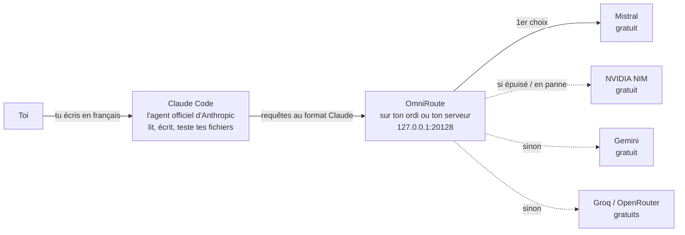

# 01 · Comment ça marche (en 2 minutes)

- **Claude Code** : le programme d'Anthropic qui travaille dans tes dossiers (créer des fichiers, lancer des commandes, tester un site). Il est gratuit à installer ; ce qui coûte normalement, c'est le modèle d'IA derrière.
- **OmniRoute** : un logiciel libre (licence MIT) qui se fait passer pour l'API de Claude. Claude Code lui envoie ses requêtes, OmniRoute les traduit et les envoie à un modèle gratuit.
- **La combinaison `gratuit`** : la liste ordonnée de tes modèles gratuits. Si le premier répond « quota épuisé » ou tombe en panne, OmniRoute passe au suivant **tout seul**, sans que tu voies rien.

## Ce qu'on a vérifié en vrai (18/11/2026)
| Test | Résultat |
|---|---|
| Claude Code 2.1.327 → OmniRoute 3.8.54 → fournisseur | ✅ réponse reçue, traduction automatique du format |
| 1er fournisseur en panne (erreur 401) dans la combinaison | ✅ bascule automatique sur le 2e, réponse normale |
| Installation complète sur une machine vierge (sans Node ni Claude) | ✅ Node 26 + Claude Code + OmniRoute + config, voir [02](02-installation-pc.md) |
| Démarrage de Claude Code avec le kit | ✅ aucun écran de connexion Anthropic, aucun écran d'accueil |
| Fournisseurs « sans clé » (Pollinations, UncloseAI) | ❌ demandent une clé aujourd'hui : il faut 1 clé gratuite minimum |
| Coût fixe d'un message Claude Code | ~14 000 tokens (mesuré) |

## Gratuit, mais pas magique (comparatif honnête)
| | Kit gratuit (ce kit) | Claude Pro (~20 €/mois) | Kiro / Antigravity « Claude gratuit » |
|---|---|---|---|
| Outil | Claude Code | Claude Code | Claude Code via proxy |
| Modèle | Mistral, NVIDIA, Gemini... | Claude Sonnet / Opus | Claude Sonnet / Opus |
| Qualité sur gros projets | bonne à très bonne | excellente | excellente |
| Coût | 0 € | abonnement | 0 € |
| Conditions d'utilisation | respectées (usage perso) | respectées | **violées** : risque de compte banni |
| Limites | quotas gratuits (bascule auto) | limites de l'abonnement | quotas minuscules + bannissement |

La stratégie la plus solide si tu as un peu de budget : **Claude Pro en principal** (`claude`) et **le kit en secours** (`claude-gratuit`) quand tu atteins la limite. L'installeur te pose la question.

## Ta vie privée
- OmniRoute tourne chez toi : pas d'intermédiaire dans le cloud, tes clés sont chiffrées sur ton disque.
- Mais chaque requête part chez le fournisseur choisi (Mistral, Google...). Les offres gratuites peuvent utiliser tes requêtes pour entraîner leurs modèles. Pas de mots de passe, pas de données clients sensibles dans tes conversations.
