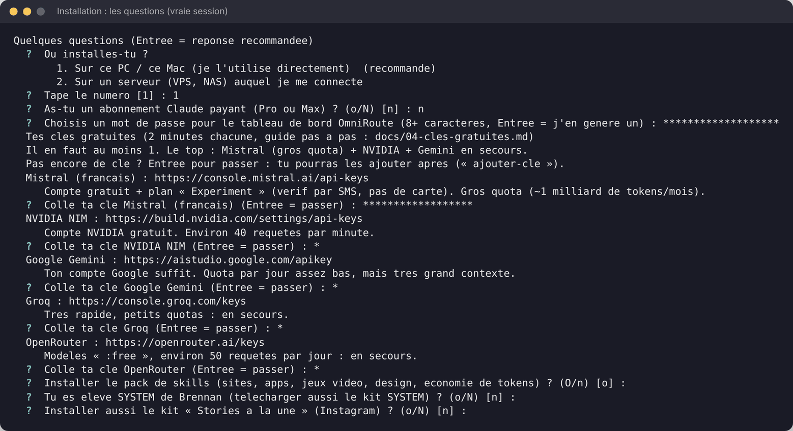
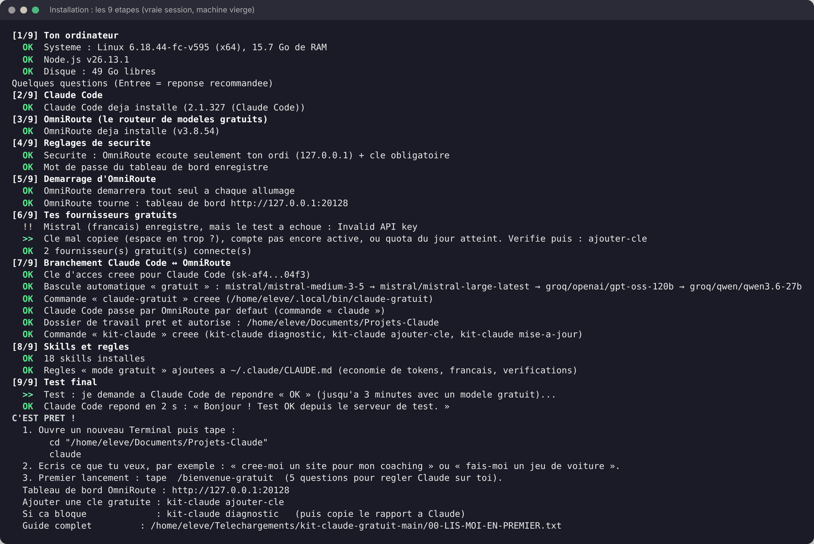

# 02 · Installation sur PC (Windows, Mac, Linux)

> Tu as un serveur (VPS, NAS) ? Va plutôt sur [03-installation-serveur.md](03-installation-serveur.md) : c'est mieux.

## Avant de commencer (2 minutes)
- Récupère au moins 1 clé gratuite : [04-cles-gratuites.md](04-cles-gratuites.md) (Mistral recommandé).
- Télécharge le kit : https://github.com/Camel974/kit-claude-gratuit/archive/refs/heads/main.zip puis **dézippe** (clic droit → « Extraire tout » sur Windows, double-clic sur Mac).

## Windows 10 / 11
1. Ouvre le dossier `kit-claude-gratuit-main` et **double-clique sur `DEMARRER-WINDOWS.bat`**.
   - Écran bleu « Windows a protégé votre ordinateur » : **Informations complémentaires** → **Exécuter quand même**.
2. Le script installe ce qui manque, sans droits administrateur :
   - Node.js (dans ton dossier perso), Git pour Windows (optionnel, Windows peut demander une autorisation), Claude Code (installeur officiel), OmniRoute.
3. Réponds aux questions (voir plus bas). Pour **coller** une clé dans la fenêtre noire : **clic droit**.
4. Des lignes jaunes `npm warn ...` défilent pendant 2 minutes : **c'est normal**.
5. Fin : `C'EST PRET !` → note le **mot de passe** du tableau de bord.

Sans dézipper : ouvre PowerShell et colle
```powershell
irm https://raw.githubusercontent.com/Camel974/kit-claude-gratuit/main/scripts/installer-windows.ps1 | iex
```

## Mac
1. Dans le dossier dézippé : **clic droit sur `DEMARRER-MAC.command` → Ouvrir → Ouvrir** (le double-clic simple est bloqué par macOS la première fois).
2. Pour coller une clé : **Cmd + V**.

Sans dézipper : ouvre l'app **Terminal** (Cmd + Espace → « Terminal ») et colle
```bash
curl -fsSL https://raw.githubusercontent.com/Camel974/kit-claude-gratuit/main/installer.sh | bash
```

## Linux (PC)
```bash
bash installer.sh
```

## Les questions de l'installeur (et quoi répondre)
| Question | Réponse conseillée |
|---|---|
| Où installes-tu ? | 1 (ce PC) ; 2 si tu es connecté en SSH à un serveur |
| As-tu un abonnement Claude payant (Pro ou Max) ? | **non** si tu n'en as pas → `claude` passe par le gratuit. **oui** → `claude` reste sur ton abonnement et `claude-gratuit` passe par le gratuit |
| Mot de passe du tableau de bord | 8 caractères ou plus, ou Entrée pour qu'il en génère un (il l'affiche à la fin) |
| Colle ta clé Mistral / NVIDIA / Gemini / Groq / OpenRouter | colle celles que tu as, Entrée pour passer les autres |
| Installer le pack de skills ? | Oui (sites, applis, jeux, économie de tokens) |
| Élève SYSTEM ? | oui seulement si Brennan t'a donné accès au kit SYSTEM |
| Kit « Stories à la une » ? | oui si tu fais de l'Instagram |

## Ce que tu verras (vraie session sur une machine vierge, 18/11/2026)
Les questions :



Puis les 9 étapes. Ici, la clé Mistral était **volontairement fausse** pour vérifier que le kit le signale et que la bascule passe au fournisseur suivant (un fournisseur de test) : c'est ce qui s'est passé, et Claude Code a répondu en 2 secondes.



Extrait (texte copiable) :
```
[5/9] Demarrage d'OmniRoute
  OK  OmniRoute demarrera tout seul a chaque allumage
  OK  OmniRoute tourne : tableau de bord http://127.0.0.1:20128
[6/9] Tes fournisseurs gratuits
  !!  Mistral (francais) enregistre, mais le test a echoue : Invalid API key
  OK  2 fournisseur(s) gratuit(s) connecte(s)
[7/9] Branchement Claude Code ↔ OmniRoute
  OK  Bascule automatique « gratuit » : mistral/mistral-medium-3-5 → mistral/mistral-large-latest → groq/openai/gpt-oss-120b → groq/qwen/qwen3.6-27b
[8/9] Skills et regles
  OK  18 skills installes
[9/9] Test final
  OK  Claude Code repond en 2 s
C'EST PRET !
```
Temps mesurés : première installation complète **~3 minutes** sur un serveur 4 cœurs avec une bonne connexion (dont 2 minutes pour OmniRoute), relance **10 secondes**. Compte 10 à 15 minutes sur un PC moyen avec les questions.

## Après l'installation
1. Ouvre un **nouveau** terminal (l'ancien ne connaît pas encore les nouvelles commandes).
2. `cd Documents/Projets-Claude` puis `claude` (ou `claude-gratuit`).
3. Tape `/bienvenue-gratuit`.


## Ce que le kit a modifié (transparence)
| Fichier | Changement | Retour arrière |
|---|---|---|
| `~/.claude/settings.json` | section `env` : adresse d'OmniRoute, clé, modèle `gratuit` (sauf si tu as un abonnement) | `kit-claude desinstaller` |
| `~/.claude.json` | saute l'écran d'accueil, autorise `Documents/Projets-Claude` | idem |
| `~/.claude/CLAUDE.md` | un bloc « Mode Claude Gratuit » entre 2 marqueurs (le reste est intact) | idem |
| `~/.claude/skills/` | les skills du kit (les tiens sont gardés) | idem |
| `~/.omniroute/.env` | `OMNIROUTE_SERVER_HOST=127.0.0.1`, `REQUIRE_API_KEY=true` | à la main |
| `~/.local/bin/` | commandes `claude-gratuit` et `kit-claude` | `kit-claude desinstaller` |
Chaque fichier modifié est d'abord copié dans `~/.claude/backups/kit-claude-gratuit-<date>/`.
