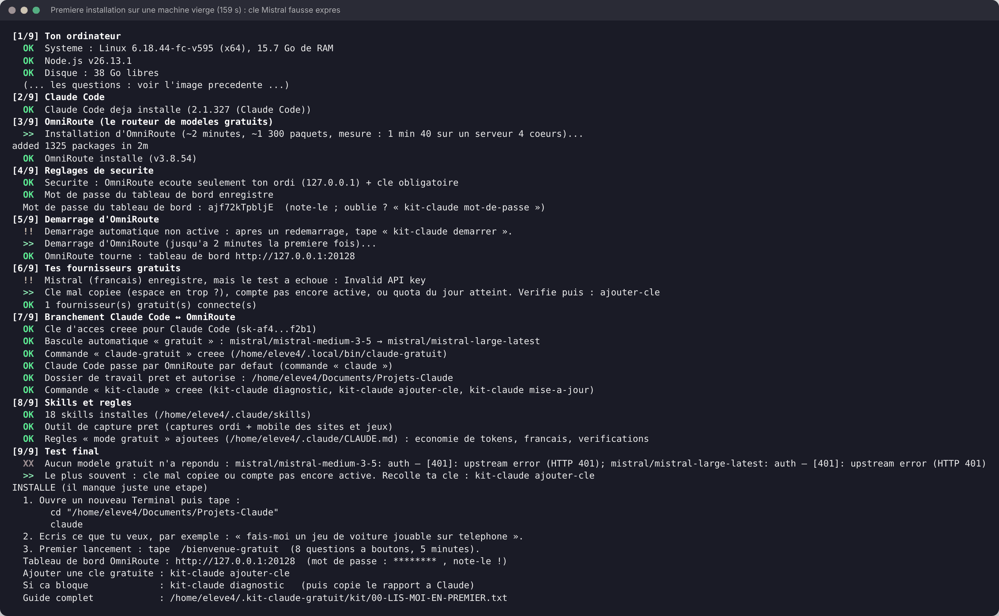
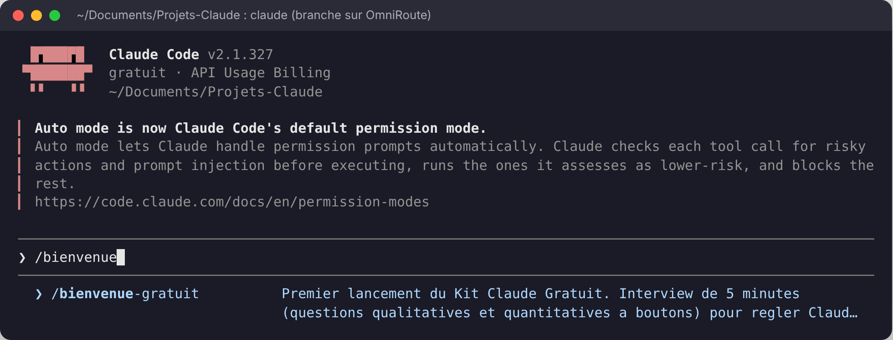

# 02 · Installation sur PC (Windows, Mac, Linux)

> Tu as un serveur (VPS, NAS) ? Va plutôt sur [03-installation-serveur.md](03-installation-serveur.md) : c'est mieux.

## Avant de commencer (2 minutes)
- Récupère au moins 1 clé gratuite : [04-cles-gratuites.md](04-cles-gratuites.md) (Mistral recommandé).
- Télécharge le kit : https://github.com/Camel974/kit-claude-gratuit/archive/refs/heads/main.zip puis **dézippe** (clic droit → « Extraire tout » sur Windows, double-clic sur Mac).

## Windows 10 / 11
1. Ouvre le dossier `kit-claude-gratuit-main` et **double-clique sur `DEMARRER-WINDOWS.bat`**.
   - Écran bleu « Windows a protégé votre ordinateur » : **Informations complémentaires** → **Exécuter quand même**.
2. Le script installe ce qui manque, sans droits administrateur :
   - Node.js (dans ton dossier perso), Git pour Windows (optionnel, Windows peut demander une autorisation), Claude Code (installeur officiel), OmniRoute.
3. Réponds aux questions (voir plus bas). Pour **coller** une clé dans la fenêtre noire : **clic droit**.
   - « Installer Git pour Windows ? » : Entrée, puis **Oui** quand Windows demande l'autorisation (c'est la seule fois). Git donne à Claude un vrai terminal ; sans lui, Claude utilise PowerShell.
4. Des lignes jaunes `npm warn ...` défilent pendant 2 minutes : **c'est normal**.
5. Fin : `C'EST PRET !` → note le **mot de passe** du tableau de bord.

Sans dézipper : ouvre PowerShell et colle
```powershell
irm https://raw.githubusercontent.com/Camel974/kit-claude-gratuit/main/scripts/installer-windows.ps1 | iex
```

## Mac
Le plus simple (aucun blocage de macOS) : ouvre l'app **Terminal** (Cmd + Espace → « Terminal ») et colle
```bash
curl -fsSL https://raw.githubusercontent.com/Camel974/kit-claude-gratuit/main/installer.sh | bash
```
Pour coller une clé : **Cmd + V**.

Avec le zip : double-clic sur `DEMARRER-MAC.command`. Si macOS refuse (« développeur non vérifié ») : **Réglages Système → Confidentialité et sécurité → « Ouvrir quand même »** (macOS 15 Sequoia ; avant : clic droit → Ouvrir). Si le Terminal demande l'accès au dossier Téléchargements : **Autoriser**.

## Linux (PC)
```bash
bash installer.sh
```

## Les questions de l'installeur (et quoi répondre)
| Question | Réponse conseillée |
|---|---|
| Où installes-tu ? | 1 (ce PC) ; 2 si tu es connecté en SSH à un serveur |
| As-tu un abonnement Claude payant (Pro ou Max) ? | **non** (Entrée) si tu n'en as pas → `claude` passe par le gratuit. **o** si tu en as un → `claude` reste ton abonnement, intact, et `claude-gratuit` passe par le gratuit dans un profil séparé. Si tu es déjà connecté à Claude sur l'ordi, « oui » est proposé par défaut |
| Mot de passe du tableau de bord | 8 caractères ou plus, ou Entrée pour qu'il en génère un (il l'affiche à la fin) |
| Colle ta clé Mistral / NVIDIA / Gemini / Groq / OpenRouter | colle celles que tu as, Entrée pour passer les autres |
| Installer le pack de skills ? | Oui (sites, applis, jeux, économie de tokens) |
| Élève SYSTEM ? | oui seulement si Brennan t'a donné accès au kit SYSTEM |
| Kit « Stories à la une » ? | oui si tu fais de l'Instagram |

## Ce que tu verras (vraie session sur une machine vierge, 18/11/2026)
Les questions :


Puis les 9 étapes. **Première installation sur une machine vierge** (ni Node, ni Claude Code) : 159 secondes au total. Ici la clé Mistral était **volontairement fausse** : le kit le voit tout de suite, explique pourquoi et dit quoi faire.



Et une fois une clé valide en place, la bascule fait son travail. Ci-dessous une relance (10 secondes) : la clé Mistral est toujours fausse, OmniRoute bascule sur le fournisseur suivant (un fournisseur de test) et Claude Code répond en 2 secondes.


Extrait (texte copiable) :
```
[5/9] Demarrage d'OmniRoute
  OK  OmniRoute demarrera tout seul a chaque allumage
  OK  OmniRoute tourne : tableau de bord http://127.0.0.1:20128
[6/9] Tes fournisseurs gratuits
  !!  Mistral (francais) enregistre, mais le test a echoue : Invalid API key
  OK  2 fournisseur(s) gratuit(s) connecte(s)
[7/9] Branchement Claude Code ↔ OmniRoute
  OK  Bascule automatique « gratuit » : mistral/mistral-medium-3-5 → mistral/mistral-large-latest → groq/openai/gpt-oss-120b → groq/qwen/qwen3.6-27b
[8/9] Skills et regles
  OK  18 skills installes
[9/9] Test final
  OK  Claude Code repond en 2 s
C'EST PRET !
```
Temps mesurés : première installation complète **159 secondes** sur un serveur 4 cœurs avec une bonne connexion (dont 2 minutes pour OmniRoute), relance **8 à 10 secondes**. Compte 10 à 15 minutes sur un PC moyen avec les questions.

## Après l'installation
1. **Double-clic sur « Claude Gratuit »** sur ton Bureau : Claude s'ouvre dans ton dossier de projets.
2. Ou à la main : ouvre un **nouveau** terminal (l'ancien ne connaît pas les nouvelles commandes), tape la ligne `cd "..."` affichée à la fin de l'installation, puis `claude` (ou `claude-gratuit`). Avec OneDrive, ton dossier Documents est souvent dans `OneDrive\Documents` : l'installeur le trouve tout seul et affiche le bon chemin.
3. Tape `/bienvenue-gratuit`.



## Ce que le kit a modifié (transparence)
| Fichier | Sans abonnement (mode gratuit) | Avec abonnement Claude | Retour arrière |
|---|---|---|---|
| Réglages Claude Code | `~/.claude/settings.json` : section `env` (OmniRoute, clé, modèle `gratuit`) + `permissions.defaultMode: manual` | rien dans `~/.claude` ; tout va dans le profil séparé `~/.claude-gratuit/` | `kit-claude desinstaller` |
| Écran d'accueil, confiance du dossier | `~/.claude.json` (accueil vu, dossier Projets-Claude autorisé) | `~/.claude-gratuit/.claude.json` | laissés tels quels (sans effet ailleurs) |
| Règles | bloc « Mode Claude Gratuit » dans `~/.claude/CLAUDE.md` (le reste intact) | `~/.claude-gratuit/CLAUDE.md` | `kit-claude desinstaller` |
| Skills | `~/.claude/skills/` (les tiens sont gardés) | `~/.claude-gratuit/skills/` | `kit-claude desinstaller` |
| OmniRoute | `~/.omniroute/.env` : `OMNIROUTE_SERVER_HOST=127.0.0.1`, `REQUIRE_API_KEY=true` | idem | à la main |
| Commandes | `claude-gratuit`, `kit-claude` dans `~/.local/bin` + raccourci Bureau | idem | `kit-claude desinstaller` |
Chaque fichier modifié est d'abord copié dans `~/.claude/backups/kit-claude-gratuit-<date>/`. Une copie du kit est gardée dans `~/.kit-claude-gratuit/kit` (Windows : `%LOCALAPPDATA%\kit-claude-gratuit\kit`) : tu peux supprimer le zip téléchargé.
