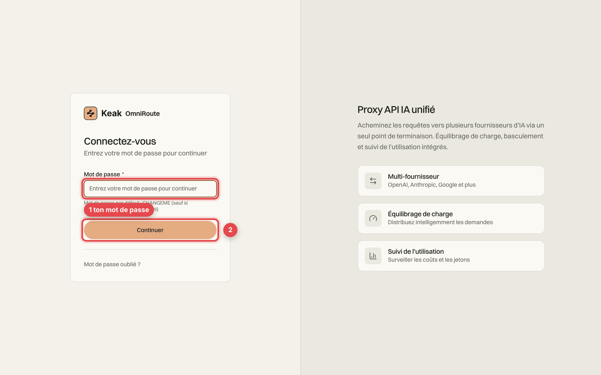
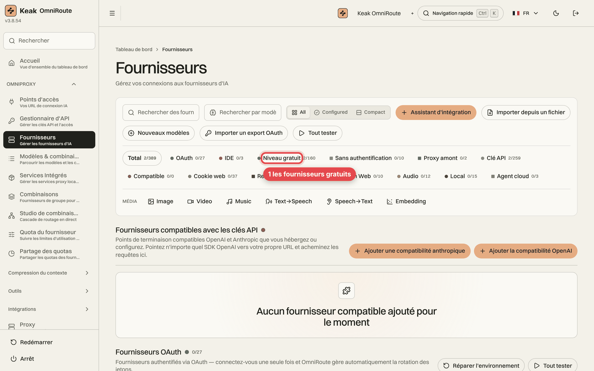
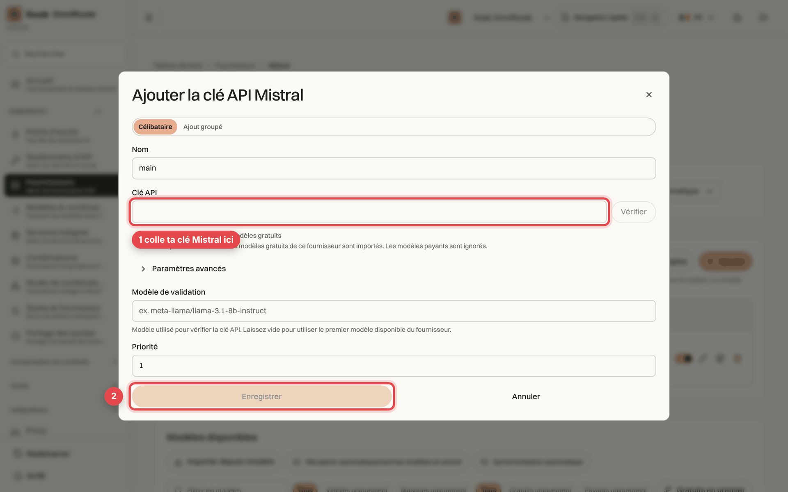
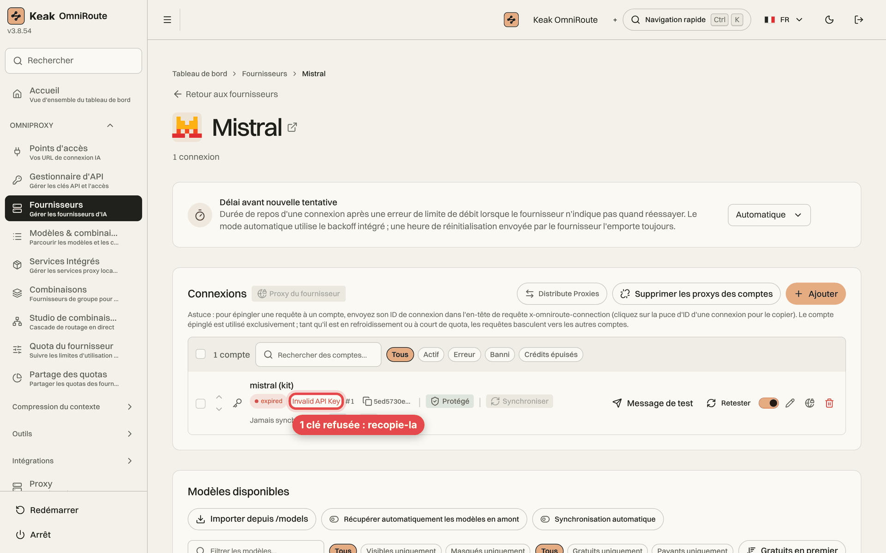

# 04 · Tes clés gratuites (pas à pas)

Une **clé API** = le mot de passe qui permet à OmniRoute d'utiliser un modèle d'IA en ton nom. Elle est gratuite, mais personnelle : ne la publie jamais, ne la colle jamais dans un chat (même avec Claude). Tu la colles seulement dans l'installeur ou dans `kit-claude ajouter-cle`.

> Testé le 18/11/2026 : **aucun fournisseur « sans clé » ne marche aujourd'hui** (Pollinations et UncloseAI répondent « clé obligatoire »), même si certains catalogues disent le contraire. Il te faut donc au moins 1 clé. Compte 2 minutes par clé.

## Lesquelles prendre ?

| Fournisseur | Quota gratuit (catalogue OmniRoute, nov. 2026) | Ce qu'il faut | Rôle dans le kit |
|---|---|---|---|
| **Mistral** (France) | ~1 milliard de tokens/mois, ~1 requête/s | compte + SMS, pas de carte | **n°1** : gros volume, bon en code |
| **NVIDIA NIM** | sans plafond de tokens publié, ~40 requêtes/min | compte NVIDIA | **n°2** : bascule quand Mistral sature |
| **Google Gemini** | quota par jour assez bas (de 20 à quelques centaines de requêtes selon le modèle) | compte Google | secours, contexte géant (1 million de tokens) |
| **Groq** | petits quotas quotidiens, très rapide | compte | secours rapide |
| **OpenRouter** | modèles `:free`, ~50 requêtes/jour | compte | dernier secours |

Combien de clés selon ton usage (estimation : 1 h de travail actif ≈ 60 à 120 requêtes ≈ 2 à 4 millions de tokens) :
- **Moins de 2 h/semaine** : Mistral suffit.
- **2 à 5 h** : Mistral + NVIDIA (la bascule automatique prend le relais).
- **5 à 15 h** : Mistral + NVIDIA + Gemini.
- **Plus de 15 h** : ajoute Groq + OpenRouter, ou prends l'abonnement Claude Pro pour les grosses semaines.

## A. Mistral (recommandé n°1)
1. Va sur https://console.mistral.ai et crée un compte (e-mail ou Google).
2. On te propose un abonnement : choisis **« Experiment »** (gratuit). Mistral vérifie ton numéro de téléphone par SMS. Pas de carte bancaire.
3. Dans le menu, ouvre **« API Keys »** → **« Create new key »** → donne un nom (ex. `omniroute`) → **copie la clé** (elle ne s'affiche qu'une fois).
4. À savoir : avec le plan Experiment, Mistral peut utiliser tes requêtes pour entraîner ses modèles. Pas de données sensibles de clients.

## B. NVIDIA NIM (recommandé n°2)
1. Va sur https://build.nvidia.com → **Login** → crée un compte NVIDIA.
2. Ouvre https://build.nvidia.com/settings/api-keys → **« Generate API Key »** → copie (commence par `nvapi-`).
3. Usage prévu par NVIDIA : prototypage, développement, apprentissage. Parfait pour tes projets perso.

## C. Google Gemini (secours)
1. Va sur https://aistudio.google.com/apikey (connecté à ton compte Google).
2. **« Create API key »** → choisis ou crée un projet → copie (commence par `AIza`).
3. Le quota gratuit est compté par jour (remise à zéro à minuit, heure du Pacifique). Les requêtes gratuites peuvent servir à améliorer les produits Google.

## D. Groq (bonus)
https://console.groq.com/keys → **« Create API Key »** → copie (commence par `gsk_`).

## E. OpenRouter (bonus)
https://openrouter.ai/keys → **« Create Key »** → copie (commence par `sk-or-`). Seuls les modèles qui finissent par `:free` sont gratuits.

## Ajouter une clé plus tard
Dans un terminal :
```bash
kit-claude ajouter-cle
```
Choisis le fournisseur, colle la clé (elle s'affiche en étoiles, c'est normal). Le kit la teste, puis reconstruit la bascule automatique `gratuit`.

Tu peux aussi passer par le tableau de bord (en français) :
1. Ouvre http://127.0.0.1:20128 et connecte-toi avec le mot de passe affiché à la fin de l'installation.



2. **Fournisseurs** → filtre **« Niveau gratuit »** → choisis le fournisseur (ex. Mistral).



3. **Ajouter** → colle la clé dans **« Clé API »** → **Vérifier** → **Enregistrer**. Puis tape `kit-claude bascule` dans un terminal pour que la bascule `gratuit` l'intègre.



Si la connexion affiche **« Invalid API Key »** en rouge : la clé est mal copiée ou le compte n'est pas encore activé. Recopie-la.



## Ce que le kit n'utilise volontairement pas
| Route | Pourquoi on l'évite |
|---|---|
| **Kiro** (Claude Sonnet gratuit) | Ses conditions interdisent les outils tiers comme OmniRoute. OmniRoute la marque `avoid` et l'exclut du routage auto. Risque : compte banni. |
| **Antigravity** (Claude Opus gratuit) | Les conditions de Google Antigravity interdisent l'accès via des proxys. Marquée `avoid`. Même risque. |
| Créer plusieurs comptes pour cumuler les quotas | Interdit par la plupart des fournisseurs. Un compte par personne. |
| Partager ton OmniRoute avec d'autres personnes | La plupart des conditions interdisent la revente ou le partage. Chaque élève installe le sien. |
