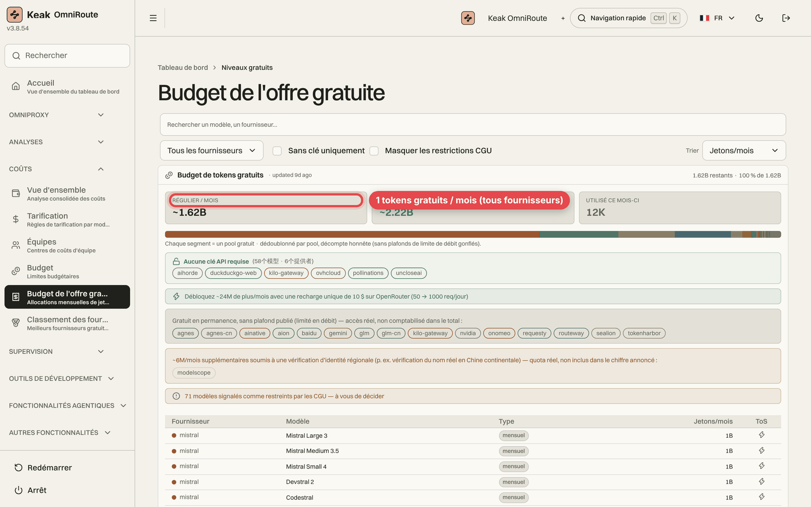

# 06 · Économiser les quotas gratuits

Le détail est dans le skill `econome` (Claude l'applique tout seul). L'essentiel :

## Les chiffres mesurés (18/11/2026)
| Mesure | Valeur |
|---|---|
| Coût fixe d'un message (instructions + outils de Claude Code) | **~14 000 tokens** en mode interactif, ~11 700 en mode `-p` |
| Avec 12 skills installés | +1 600 tokens par message |
| Avec 256 skills installés | +6 000 tokens par message (et Claude ne voit plus toutes leurs descriptions) |
| 1 action (lire un fichier, lancer une commande) | 1 aller-retour de plus, avec tout l'historique |
| Grosse sortie de commande (848 Ko) | Claude Code n'envoie qu'un aperçu de ~2 400 caractères |
| Compression OmniRoute sur des sorties de commandes (aperçu officiel) | -55 % (RTK), -64 % (RTK + Caveman), 0 % sur du texte normal |

## Les 8 réflexes
1. Un sujet = une conversation : `/clear` entre deux sujets, `/compact` quand ça s'allonge.
2. Une demande complète en un message plutôt que 5 petits.
3. Mode plan (`Maj + Tab`) avant les gros changements.
4. Cible les fichiers (`@src/index.html`) au lieu de « regarde mon projet ».
5. Pas de gros copier-coller : le chemin du fichier ou 20 lignes d'erreur.
6. CLAUDE.md court (il est envoyé à chaque message).
7. Range les skills inutiles dans `~/.claude/skills-off/`.
8. Pas de sous-agents pour des petites tâches.

## Combien de temps dure le gratuit ? (estimations)
Hypothèse : 1 h de travail actif ≈ 60 à 120 requêtes ≈ 2 à 4 millions de tokens.
| Fournisseur | Ce que ça donne en pratique |
|---|---|
| Mistral (~1 milliard/mois) | largement de quoi travailler plusieurs heures par jour |
| NVIDIA (~40 requêtes/min, pas de plafond de tokens publié) | limité par la vitesse, pas par le volume |
| Gemini gratuit (20 à quelques centaines de requêtes/jour selon le modèle) | de 10 minutes à 2 h par jour : en secours |
| Groq / OpenRouter | quelques dizaines de requêtes : dernier secours |
Les quotas réels de ton compte sont dans le tableau de bord : **Coûts → Budget de l'offre gratuite** et **Quota du fournisseur**.

## Changer l'ordre de la bascule
Tableau de bord http://127.0.0.1:20128 → **Combinaisons** → `gratuit` → glisse les modèles. Ou relance `kit-claude ajouter-cle` : il reconstruit l'ordre recommandé (Mistral → NVIDIA → Gemini → Groq → OpenRouter).
